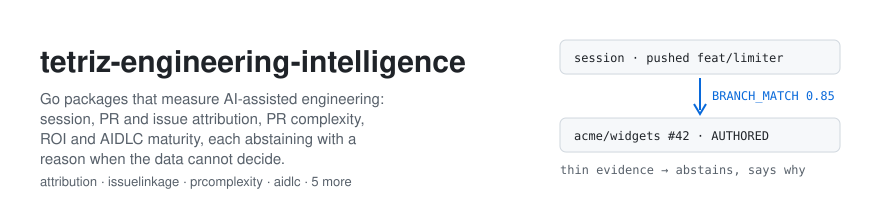
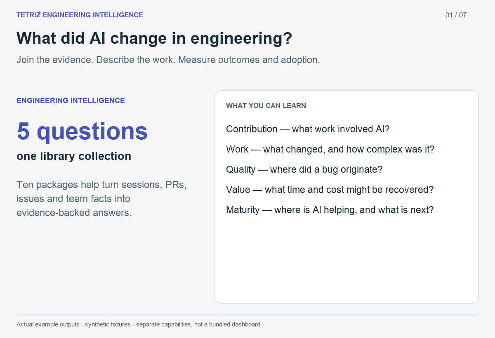

<picture>
  <source media="(prefers-color-scheme: dark)" srcset=".github/assets/banner-dark.svg">
  
</picture>

[](https://pkg.go.dev/github.com/tetriz-ai/tetriz-engineering-intelligence/attribution)
[](LICENSE)


<a href="https://www.producthunt.com/products/tetriz-engg-intelligence-connectors?embed=true&amp;utm_source=badge-featured&amp;utm_medium=badge&amp;utm_campaign=badge-tetriz-engg-intelligence-connectors" target="_blank" rel="noopener noreferrer"></a>

If you have to show what AI coding tools changed in your team's delivery, the evidence sits in
session logs, pull requests and tracker issues that nothing joins. These ten Go packages join the
records you supply, all offline except `prworktype`. They link sessions to pull requests and pull
requests to issues, label, size and score pull requests, record branch promotions, trace a bug fix
back to the change that introduced it, measure return on investment and the AI share of issues,
and place an organisation on a lifecycle maturity grid.



Contribution, work, quality, value and maturity—from runnable examples. [Walkthrough](.github/assets/demo/README.md).

## Contents

- [Packages](#packages) says what this repository holds.
- [What attribution does](#what-attribution-does) lists the entry points, which read sessions and
  pull requests you supply, and what they do not do.
- [Quick start](#quick-start) runs one `attribution` program offline. Each other package's README has its own quick start.
- [Choosing an entry point](#choosing-an-entry-point) says which `attribution` entry point fits your data.
- [Usage](#usage) gives a complete program for each entry point.
- [Reference](#reference) states the exact rules each entry point follows.
- [Before you rely on it](#before-you-rely-on-it) lists the limits to know before shipping.
- [Project](#project) covers versioning, tests, contributing, security and license.

## Packages

This repository is one Go module, `github.com/tetriz-ai/tetriz-engineering-intelligence`.

| Package | What it does |
|---|---|
| [`attribution`](attribution/) | Links AI coding sessions to the pull requests they produced, with the evidence for every match, or abstains with a reason. |
| [`prcomplexity`](prcomplexity/README.md) | Scores a pull request from 1.0 to 10.0 against its own repository's recent merged PRs, one language at a time. |
| [`diffsize`](diffsize/README.md) | Turns a diff into per-language effective lines of code, the sizes `prcomplexity` reads. |
| [`prworktype`](prworktype/README.md) | Labels a pull request's **type** (feature, bugfix, refactor, …) and **domain** (infra-devops, data-pipeline, …) from its title and branch, through a rules → embedding → LLM cascade. It is **not pure-Go and not offline**: the embedding model (MiniLM) and the LLM run in a companion Python service, [`model-service`](model-service/README.md), and the Go package is a thin client that calls it over HTTP. |
| [`defectlineage`](defectlineage/README.md) | Traces a merged bug fix back to the changes most likely to have introduced the bug, each with the evidence behind it, and ranks them. Runs offline with its in-memory store; PostgreSQL keeps what it traces. |
| [`aidlc`](aidlc/README.md) | Places one organisation on an AI development lifecycle (AIDLC) maturity grid, nine lifecycle stages by five levels of AI autonomy, and says what holds each stage back. [docs/aidlc/method.md](docs/aidlc/method.md) is the method. |
| [`airoi`](airoi/README.md) | Turns AI-attributed vs non-AI pull-request cohorts into a class-corrected, quality-discounted ROI measurement — recovered hours and read-time dollars — abstaining with a reason when the data can't support the claim. |
| [`branchlineage`](branchlineage/README.md) | Records which pull requests each promotion carried from one branch to the next, so work merged into an integration branch is credited when a promotion lands it on the tracked branch. |
| [`issuelinkage`](issuelinkage/README.md) | Links pull requests to the tracker issues they deliver or mention, from titles, bodies, branch names and the links GitHub, GitLab and Linear record, keeping a closing link apart from a mention, with the evidence for each. |
| [`issueattribution`](issueattribution/README.md) | Measures the share of completed issues AI-assisted pull requests delivered, with how many issues have a linked pull request at all, and no share rather than a zero when none does. |

Each package is documented on
[pkg.go.dev](https://pkg.go.dev/github.com/tetriz-ai/tetriz-engineering-intelligence).

The sections below cover `attribution`. Each other package has its own README, linked above.

## What attribution does

Use it when you have AI coding-session logs and pull-request data, and want to know which pull
requests each session produced.

An agent session leaves traces, such as the branch it pushed, a pull request it named and the
files it edited. The engine reads those traces and decides which pull requests the session
contributed to. Every match carries its method and confidence, and the evidence that made it
specific when there is some, while a session with thin evidence abstains with a stated reason.

- **`attribution.New(params, candidates, identities) *Engine`** builds the engine from your
  `CandidateStore` and `IdentityResolver`.
- **`(*Engine).Attribute(ctx, orgID, sessions) ([]MatchResult, error)`** attributes one batch.
  Each result is a match list or an abstention with its reason.
- **`runner.New(engine, source, observer).RunBatch(ctx, orgID, limit)`** loads pending
  sessions from a store, attributes them and writes the merged result back.
- **`attribution.IsPending`, `Reduce` and `ReattributionWindow`** let your own worker pick a
  batch, merge each result into what it stores, and reopen sessions when a pull request merges.
- **`memory.New()` and `sqlite.Open(path)`** are the two reference stores. Memory is for tests
  and first runs. SQLite survives restarts. Each store has one writer: run one worker per store.
- **`localsession.Convert` and `vcs.Convert`** turn a session extractor's export and a
  connector's pull-request records into the engine's evidence. A session extractor is any tool
  that reads an agent's local files and writes one JSON object per session, in the shape of
  `localsession.Row`: agent-desk's local-session-extractor writes it with `export --raw`. A
  connector's record is one event of tetriz-connectors' envelope, as
  [Convert exported data](#convert-exported-data) says. If you already hold sessions, build
  `SessionEvidence` directly and skip the adapters.
- **`signature.ScanCommitMessage`, `ScanPRDescription` and `ScanReviewBody`** find the
  signatures AI coding tools leave in text.

The engine is stateless. It reads the sessions and candidates you hand it and returns results.
A runner over a store makes attribution stateful, because the store keeps each session's
attribution and merges every new result into it.

**What it does not do:**

- It does not fetch sessions or pull requests. You supply both, through the two interfaces.
- It does not map people to vendor accounts. Your `IdentityResolver` does that.
- It does not call a network service, a model or a hosted API.

## Quick start

You need Go 1.25.2 or newer, and nothing else: no service, account or credential. Start a module.

```sh
mkdir try && cd try && go mod init example.com/try
```

Save this as `main.go`.

```go
// Command match-one-session attributes one session to the pull request it names.
package main

import (
	"context"
	"fmt"
	"log"
	"time"

	"google.golang.org/protobuf/types/known/timestamppb"

	"github.com/tetriz-ai/tetriz-engineering-intelligence/attribution"
	attributionv1 "github.com/tetriz-ai/tetriz-engineering-intelligence/gen/attribution/v1"
)

// pullRequests is where candidates come from: your own VCS data.
type pullRequests []*attributionv1.PRCandidate

func (p pullRequests) ListAuthoredPRs(context.Context, string, []string, time.Time, time.Time) ([]*attributionv1.PRCandidate, error) {
	return p, nil
}

func (pullRequests) ListReviewedPRs(context.Context, string, []string, time.Time, time.Time) ([]*attributionv1.PRCandidate, error) {
	return nil, nil
}

// people maps a person to the vendor accounts they work under.
type people struct{}

func (people) Resolve(context.Context, string, string) (attribution.Identity, error) {
	return attribution.Identity{AuthorIDs: []string{"ada"}}, nil
}

func main() {
	day := timestamppb.New(time.Date(2026, 3, 1, 0, 0, 0, 0, time.UTC))
	prs := pullRequests{{PrKey: "acme/widgets#42", PrRepository: "acme/widgets", PrNumber: 42, MergedAt: day}}
	session := &attributionv1.SessionEvidence{
		SessionId: "s1", PersonId: "ada", StartDate: day,
		PrReferences: []*attributionv1.PRReference{{PrNumber: 42, PrRepository: "acme/widgets"}},
	}

	engine := attribution.New(attribution.Params{}, prs, people{})
	results, err := engine.Attribute(context.Background(), "my-org", []*attributionv1.SessionEvidence{session})
	if err != nil {
		log.Fatal(err)
	}
	for _, m := range results[0].Attribution.GetMatches() {
		fmt.Println(m.GetPrKey(), m.GetMethod(), m.GetConfidence())
	}
	// Output: acme/widgets#42 SESSION_TO_PR_MATCH_METHOD_DIRECT_PR_REF 1
}
```

Add the module, fetch its dependencies and run it. The `go get` line resolves once v0.1.0 is
tagged.

```sh
go get github.com/tetriz-ai/tetriz-engineering-intelligence@v0.1.0
go mod tidy
go run .
```

```text
acme/widgets#42 SESSION_TO_PR_MATCH_METHOD_DIRECT_PR_REF 1
```

## Choosing an entry point

| You have | Use | Example |
|---|---|---|
| Sessions and pull requests already in memory | [`Engine.Attribute`](#attribute-a-batch) | [match-one-session](examples/match-one-session/) |
| A schedule, and results to keep between runs | [`runner` with a store](#run-batches-over-a-store) | [run-batches-on-sqlite](examples/run-batches-on-sqlite/) |
| Your own worker, and pull requests that merge later | [`IsPending`, `Reduce`, `ReattributionWindow`](#re-attribute-when-a-pull-request-merges) | [reattribute-on-merge](examples/reattribute-on-merge/) |
| A session extractor's export and a connector's records | [the adapters](#convert-exported-data) | [attribute-exported-sessions](examples/attribute-exported-sessions/) |
| Your own metrics system | [an `Observer`](#watch-the-engine) | [count-engine-events](examples/count-engine-events/) |
| Commit, pull-request or review text | [`signature`](#scan-text-for-ai-signatures) | [scan-text-for-ai-signatures](examples/scan-text-for-ai-signatures/) |

Every entry point reads the same evidence contract, the messages in `proto/attribution/v1`.

## Usage

### Attribute a batch

When: you hold a batch of sessions and can list each person's pull requests.

```go
// Command attribute-a-batch attributes two sessions, one of which abstains.
package main

import (
	"context"
	"fmt"
	"log"
	"time"

	"google.golang.org/protobuf/types/known/timestamppb"

	"github.com/tetriz-ai/tetriz-engineering-intelligence/attribution"
	attributionv1 "github.com/tetriz-ai/tetriz-engineering-intelligence/gen/attribution/v1"
)

type pullRequests []*attributionv1.PRCandidate

func (p pullRequests) ListAuthoredPRs(context.Context, string, []string, time.Time, time.Time) ([]*attributionv1.PRCandidate, error) {
	return p, nil
}

func (pullRequests) ListReviewedPRs(context.Context, string, []string, time.Time, time.Time) ([]*attributionv1.PRCandidate, error) {
	return nil, nil
}

// people links ada only, so grace's session abstains.
type people struct{}

func (people) Resolve(_ context.Context, _, person string) (attribution.Identity, error) {
	if person != "ada" {
		return attribution.Identity{}, nil
	}
	return attribution.Identity{AuthorIDs: []string{"ada"}}, nil
}

func main() {
	day := timestamppb.New(time.Date(2026, 3, 1, 0, 0, 0, 0, time.UTC))
	prs := pullRequests{{
		PrKey: "acme/widgets#7", PrRepository: "acme/widgets", PrNumber: 7, MergedAt: day,
		FilesChanged:      []string{"limiter/bucket.go", "limiter/window.go"},
		ParticipationKind: attributionv1.SessionParticipationKind_SESSION_PARTICIPATION_KIND_AUTHORED,
	}}
	sessions := []*attributionv1.SessionEvidence{
		{SessionId: "edits", PersonId: "ada", StartDate: day, FilesEdited: []string{"limiter/bucket.go", "limiter/window.go"}},
		{SessionId: "unlinked", PersonId: "grace", StartDate: day},
	}

	results, err := attribution.New(attribution.Params{}, prs, people{}).Attribute(context.Background(), "my-org", sessions)
	if err != nil {
		log.Fatal(err)
	}
	// Results are grouped by person, so read them back in the batch's order.
	byID := map[string]attribution.MatchResult{}
	for _, r := range results {
		byID[r.Session.GetSessionId()] = r
	}
	for _, s := range sessions {
		r := byID[s.GetSessionId()]
		for _, m := range r.Attribution.GetMatches() {
			fmt.Println(s.GetSessionId(), m.GetMethod(), m.GetConfidence(), m.GetEvidence())
		}
		if u := r.Attribution.GetUnmatched(); u != nil {
			fmt.Println(s.GetSessionId(), "abstained:", u.GetReason())
		}
	}
}
```

```text
edits SESSION_TO_PR_MATCH_METHOD_FILE_OVERLAP 1 SESSION_TO_PR_MATCH_EVIDENCE_FILE_OVERLAP
unlinked abstained: SESSION_TO_PR_UNMATCHED_REASON_VCS_NOT_LINKED
```

Remember:

- **Results come grouped by person, not in input order.** Look a session up by its id.
- **Sort a session's matches before you print or compare them.** See
  [Depends on the batch](#depends-on-the-batch).
- **Return new candidate objects on every call.** The engine writes each candidate's side onto
  the object your store returns.
- **A session can be missing from the results.** That happens when its candidates could not be
  fetched, or when resolving its person failed and it already holds matches. It stays pending,
  and your `Observer` hears why.

### Run batches over a store

When: attribution runs on a schedule, and each run should pick up only what changed.

```go
// Command run-batches runs the batch runner twice over the in-memory store.
package main

import (
	"context"
	"fmt"
	"log"
	"time"

	"google.golang.org/protobuf/types/known/timestamppb"

	"github.com/tetriz-ai/tetriz-engineering-intelligence/attribution"
	"github.com/tetriz-ai/tetriz-engineering-intelligence/attribution/runner"
	"github.com/tetriz-ai/tetriz-engineering-intelligence/attribution/runner/memory"
	attributionv1 "github.com/tetriz-ai/tetriz-engineering-intelligence/gen/attribution/v1"
)

type noPullRequests struct{}

func (noPullRequests) ListAuthoredPRs(context.Context, string, []string, time.Time, time.Time) ([]*attributionv1.PRCandidate, error) {
	return nil, nil
}

func (noPullRequests) ListReviewedPRs(context.Context, string, []string, time.Time, time.Time) ([]*attributionv1.PRCandidate, error) {
	return nil, nil
}

type linked struct{}

func (linked) Resolve(context.Context, string, string) (attribution.Identity, error) {
	return attribution.Identity{AuthorIDs: []string{"ada"}}, nil
}

func main() {
	store := memory.New()
	store.Put("my-org", &attributionv1.SessionEvidence{SessionId: "s1", PersonId: "ada", StartDate: timestamppb.Now()})
	r := runner.New(attribution.New(attribution.Params{}, noPullRequests{}, linked{}), store, nil)

	for run := 1; run <= 2; run++ {
		result, err := r.RunBatch(context.Background(), "my-org", 100)
		if err != nil {
			log.Fatal(err)
		}
		fmt.Printf("run %d: %d session(s), %d without a matching pull request\n",
			run, result.Sessions, result.Breakdown.UnmatchedNoMatchingPR)
	}
}
```

```text
run 1: 1 session(s), 1 without a matching pull request
run 2: 0 session(s), 0 without a matching pull request
```

Remember:

- **An abstained session waits out its cooldown, 12 hours by default.** The store applies the
  retry policy, so set `store.Params.RetryCooldownHours` and `store.Params.MaxRetryDays`, and set
  `store.Params.MaxSessionSpanDays` to the engine's value. The engine's `Params` does not reach
  the store.
- **Run one worker per store.** A store holds nothing between a load and its write, so two
  workers over one store would attribute a session twice.
- **Swap `memory.New()` for `sqlite.Open(path)`** to keep results across restarts. The full
  program is in [run-batches-on-sqlite](examples/run-batches-on-sqlite/).

### Re-attribute when a pull request merges

When: the engine runs inside your own worker, and a session should be looked at again once a
pull request it may have produced merges.

To reopen a session, increment its `ReattributionSeq` when the merge window contains its start
date. `IsPending` then reports it pending until `Reduce` records that request.

```go
// Command reopen-on-merge reopens a settled session when a pull request merges in its window.
package main

import (
	"fmt"
	"time"

	"google.golang.org/protobuf/types/known/timestamppb"

	"github.com/tetriz-ai/tetriz-engineering-intelligence/attribution"
	attributionv1 "github.com/tetriz-ai/tetriz-engineering-intelligence/gen/attribution/v1"
)

func main() {
	today := time.Now().UTC().Truncate(24 * time.Hour)
	session := &attributionv1.SessionEvidence{
		SessionId: "s1", StartDate: timestamppb.New(today.AddDate(0, 0, -3)),
		StoredAttribution: &attributionv1.PRAttribution{Matches: []*attributionv1.PRMatch{{
			PrKey: "acme/widgets#8", ParticipationKind: attributionv1.SessionParticipationKind_SESSION_PARTICIPATION_KIND_AUTHORED,
		}}},
	}
	fmt.Println("pending before the merge:", attribution.IsPending(session, attribution.Params{}, time.Now()))

	// The pull request opened four days ago and merged today.
	from, to := attribution.ReattributionWindow(today.AddDate(0, 0, -4), today)
	if d := session.GetStartDate().AsTime(); !d.Before(from) && !d.After(to) {
		session.ReattributionSeq++
	}
	fmt.Println("pending after the merge:", attribution.IsPending(session, attribution.Params{}, time.Now()))
}
```

```text
pending before the merge: false
pending after the merge: true
```

Remember:

- **`Reduce` records the `ReattributionSeq` it serviced.** An increment made while a batch runs
  stays outstanding, so the session is picked up again.
- **Both window bounds are inclusive dates.** The window ends on the day after the merge.

The full worker, with `Engine.Attribute` and `Reduce`, is in
[reattribute-on-merge](examples/reattribute-on-merge/).

### Convert exported data

When: your sessions come from a local session extractor and your pull requests from a VCS
connector.

```go
// Command convert-exported-data converts an extractor row and a connector record.
package main

import (
	"encoding/json"
	"fmt"
	"log"
	"time"

	"github.com/tetriz-ai/tetriz-engineering-intelligence/attribution/adapter/localsession"
	"github.com/tetriz-ai/tetriz-engineering-intelligence/attribution/adapter/vcs"
	attributionv1 "github.com/tetriz-ai/tetriz-engineering-intelligence/gen/attribution/v1"
)

func main() {
	line := `{"ide_type": "kiro", "session_id": "s1",
		"conversation": [{"role": "user", "content": "...", "timestamp": "2026-03-02T09:00:00.000Z"}],
		"session_meta": {"duration_minutes": 30, "git_branches": ["feat/limiter"]}}`
	var row localsession.Row
	if err := json.Unmarshal([]byte(line), &row); err != nil {
		log.Fatal(err)
	}
	session, err := localsession.Convert(row, "my-org", "ada")
	if err != nil {
		log.Fatal(err)
	}
	fmt.Println(session.GetIdeType(), session.GetSessionDurationSeconds(), session.GetGitBranches())

	prs := vcs.Convert([]vcs.Record{{
		ExternalID: "acme/widgets#PR-7#merged",
		DataDate:   time.Date(2026, 3, 1, 0, 0, 0, 0, time.UTC),
		Metadata:   map[string]string{"repo": "widgets", "owner": "acme", "head_branch": "feat/limiter"},
	}}, attributionv1.SessionParticipationKind_SESSION_PARTICIPATION_KIND_AUTHORED)
	fmt.Println(prs[0].GetPrRepository(), prs[0].GetPrNumber(), prs[0].GetHeadBranch())
}
```

```text
IDE_TYPE_KIRO 1800 [feat/limiter]
acme/widgets 7 feat/limiter
```

Remember:

- **Export rows, not Conversations.** `local-session-extractor export --raw --out sessions.jsonl`
  writes the rows `Row` reads. Its default export is a Session Intelligence `Conversation`, whose
  camelCase keys decode into an empty `Row`, and `Convert` refuses it with `ErrNoSessionID`.
- **The extractor knows no person or org.** It reads one machine, so give each export file the
  person whose machine wrote it, and pass both to `localsession.Convert`.
- **A connector file holds envelopes, not records.** Each line of tetriz-connectors' JSON-lines
  sink is an envelope whose `events` are the records, with camelCase keys and a base64 `payload`.
  A pull request gives an `#opened` and a `#snapshot` record, and a `#merged` record once merged
  or a `#closed` one if closed without a merge. A record can arrive more than once. Keep one copy
  of each, then pass `vcs.Convert` one `Record` per `#merged` event, with its `dataDate` as
  `DataDate`.
- **A row is converted by fixed rules.** Only the extractor's own editor names translate, so
  `"Kiro"` or `"IDE_TYPE_KIRO"` arrives as `IDE_TYPE_UNSPECIFIED` and loses Kiro's branch gate
  (see [Engine.Attribute](#engineattribute)). Session duration comes from the rules under
  [Adapters](#adapters).
- **An unparseable connector metadata field is dropped, not fatal.** The candidate can still
  match on its branch or a direct reference.

The full composition, with both sides and every abstention, is
[attribute-exported-sessions](examples/attribute-exported-sessions/).

### Watch the engine

When: you want the engine's counters and explanatory events in your own metrics.

```go
// Command watch-the-engine prints why the engine left a person's session pending.
package main

import (
	"context"
	"errors"
	"fmt"
	"log"
	"time"

	"google.golang.org/protobuf/types/known/timestamppb"

	"github.com/tetriz-ai/tetriz-engineering-intelligence/attribution"
	attributionv1 "github.com/tetriz-ai/tetriz-engineering-intelligence/gen/attribution/v1"
)

// printer is an attribution.Observer that prints why a person was skipped.
type printer struct{}

func (printer) Count(string, map[string]string)            {}
func (printer) Observe(string, float64, map[string]string) {}
func (printer) Debug(event string, fields map[string]any) {
	if event == "person_skipped" {
		fmt.Println(event, fields["person_id"], fields["reason"])
	}
}

type brokenStore struct{}

func (brokenStore) ListAuthoredPRs(context.Context, string, []string, time.Time, time.Time) ([]*attributionv1.PRCandidate, error) {
	return nil, errors.New("store unavailable")
}

func (brokenStore) ListReviewedPRs(context.Context, string, []string, time.Time, time.Time) ([]*attributionv1.PRCandidate, error) {
	return nil, nil
}

type linked struct{}

func (linked) Resolve(context.Context, string, string) (attribution.Identity, error) {
	return attribution.Identity{AuthorIDs: []string{"ada"}}, nil
}

func main() {
	session := &attributionv1.SessionEvidence{SessionId: "s1", PersonId: "ada", StartDate: timestamppb.Now()}
	engine := attribution.New(attribution.Params{Observer: printer{}}, brokenStore{}, linked{})
	results, err := engine.Attribute(context.Background(), "my-org", []*attributionv1.SessionEvidence{session})
	if err != nil {
		log.Fatal(err)
	}
	fmt.Println(len(results), "results")
}
```

```text
person_skipped ada candidate_fetch_error
0 results
```

Remember:

- **The engine calls the Observer from several goroutines.** An Observer that keeps state must guard it
  with a lock.
- **An Observer never changes a decision.** A nil Observer discards every event.

The full counter is in [count-engine-events](examples/count-engine-events/).

### Scan text for AI signatures

When: you want to know whether a commit, pull request or review says an AI tool wrote it.

```go
// Command scan-text scans pull-request text for AI-tool signatures.
package main

import (
	"fmt"

	"github.com/tetriz-ai/tetriz-engineering-intelligence/attribution/signature"
)

func main() {
	for _, body := range []string{
		"Adds a token bucket.\n\nGenerated with Claude Code",
		"Reviewer: Someothertool AI",
		"Fixes the retry loop.",
	} {
		a := signature.ScanPRDescription(body)
		fmt.Println(a.IsAIAttributed, a.Sources)
	}
}
```

```text
true [claude-code]
true [ai-unknown]
false []
```

Remember:

- **A header that names no known tool counts as `ai-unknown`.** It never names a vendor it
  cannot see.
- **Patterns do not read the words around them.** See [signature](#signature).

The full API is on [pkg.go.dev](https://pkg.go.dev/github.com/tetriz-ai/tetriz-engineering-intelligence/attribution).
Every example is indexed in [examples/README.md](examples/README.md).

## Reference

### Engine.Attribute

Three signals run in this order, and the first to match a pull request wins. A later signal that
also matches is recorded in the match's `signals_evaluated` rather than replacing it. Names here
drop their enum prefixes: `DIRECT_PR_REF` is `SESSION_TO_PR_MATCH_METHOD_DIRECT_PR_REF`.

| Signal | What it needs | Confidence |
|---|---|---|
| `DIRECT_PR_REF` | the session named the pull request | 1.0 |
| `BRANCH_MATCH` | the session's branch is the pull request's head branch | 0.85, decayed by time |
| `FILE_OVERLAP` | enough of the session's edits are in the diff | the overlap, decayed by time |

- **The gated editor** is Kiro, named by its enum name `IDE_TYPE_KIRO` in any case. Its branch
  matches need evidence specific to the session, because every session in a Kiro workspace
  shares the workspace's branch. Every other editor attributes on branch membership alone.
- **Provenance** decides whether evidence may attribute for the gated editor. A branch or
  reference the session produced counts. One only read from the workspace, or with no recorded
  source, can narrow the candidates but never carry the match.
- **Evidence** is `FILE_OVERLAP`, `PR_REFERENCE`, `BRANCH_PROVENANCE` or `UNSPECIFIED`, and
  `UNSPECIFIED` means the match was made on its method alone.
- **Candidates are written to.** See [Your store and caller must](#your-store-and-caller-must).
- **File overlap** is containment, the share of the session's edited files that are in the pull
  request. It runs on author-side candidates only, inside `TimeWindowAfterDays`.
- **Time decay** takes 0.05 per day, measured from the nearer end of the session and floored at
  0.75. A pull request that has not merged decays from its open date.
- **Participation** is `AUTHORED` or `REVIEWED`. A session on the author's own pull request
  counts as `REVIEWED` when its `task_type` is `code-review` and the store returned that pull
  request from both `ListAuthoredPRs` and `ListReviewedPRs`.
- **Errors.** `Attribute` returns an error only when an identity or match worker panics. Every
  other problem is a result or a pending session, with one of these reasons:

| Reason | Meaning |
|---|---|
| `VCS_NOT_LINKED` | the person has no vendor account, retried on the cooldown until one appears |
| `NO_MATCHING_PR` | candidates were evaluated and none qualified, permanent after `MaxRetryDays` |
| `IDENTITY_ERROR` | resolving the person failed, retried on the cooldown |

### Params

`attribution.Params{}` and `DefaultParams()` give the calibrated defaults. A field left at zero
takes its default.

A field you set is kept as set. A negative value is a mistake (see
[Your store and caller must](#your-store-and-caller-must)).

| Field | Default | Raising it |
|---|---|---|
| `TimeWindowAfterDays` | 3 | admits file overlap with later pull requests |
| `StrongSignalWindowAfterDays` | 30 | admits branch and reference matches to later pull requests |
| `MinConfidencePercent` | 30 | demands more overlap before a file match |
| `RetryCooldownHours` | 12 | waits longer between retries of an abstained session. Under a runner, set it on the store's `Params` |
| `MaxRetryDays` | 30 | retries `NO_MATCHING_PR` for longer. Under a runner, set it on the store's `Params` |
| `MaxSessionSpanDays` | 30 | lets a long session match later pull requests |
| `IdentityResolveConcurrency` | 10 | runs more identity lookups at once |
| `ComputeMatchConcurrency` | 10 | runs more match computations at once |

The defaults were calibrated on one dataset. A repository with a different review pace or naming
habits should expect to retune.

### runner and the stores

- **`RunBatch`** loads up to `limit` pending sessions, oldest first, and attributes them. It
  merges each result into what the store holds, writes it, and returns counts by signal and by
  reason.
- **Pending** is decided by `attribution.IsPending`. A session is pending when it has no
  attribution, a newer re-attribution request or a match with no participation kind. An
  abstention is pending past its cooldown when it is `VCS_NOT_LINKED` or `IDENTITY_ERROR`, or
  `NO_MATCHING_PR` within `MaxRetryDays` of the session's last activity. Any other abstention
  is settled, even after the cooldown.
- **The merge adds and does not remove.** It withdraws a stored match only when this run fetched
  that pull request and the current rules refuse it.
- **A store** implements `runner.SessionSource`, which has two methods, `LoadPending` and
  `WriteResults`. Both reference stores, `memory.Store` and `sqlite.Store`, follow the rules
  below.
- **Selection** is every pending session, oldest start date first with undated sessions last,
  then by session id, up to `limit`.
- **The write** stores each merged attribution and nothing else. A session the store does not
  hold is left out of the written count.
- **`Put` of a held session** takes the new evidence and keeps the person, the org, the start,
  the stored attribution and the `ReattributionSeq`. The last activity becomes the later of the
  two. The `ReattributionSeq` rises by one when an input the matcher reads changed: references,
  branches and their provenance, files edited, the `pr_number`, `pr_repository` and `git_branch`
  scalars, or the days the duration spans. A re-put while a batch runs does not stop its write, and the raised
  `ReattributionSeq` selects the session again.
- **`RequestReattribution`** raises the `ReattributionSeq` by one.

### Adapters

| Function | Reads | Writes |
|---|---|---|
| `localsession.Convert` | one extractor row | `SessionEvidence` |
| `vcs.Convert` | connector records | `PRCandidate`s, stamped with the side you pass |

- **Editor names** are the extractor's own, `claude-code`, `cursor`, `copilot`, `antigravity`,
  `codex` and `kiro`, and become enum names like `IDE_TYPE_KIRO`. Any other value becomes
  `IDE_TYPE_UNSPECIFIED`.
- **Duration** (`session_duration_seconds`) is Kiro's own `duration_minutes`, converted to
  seconds. For every other editor, and for a Kiro row without `duration_minutes`, it is the
  row's last file change minus the start below, and zero when that is not positive.
- **Start** is the first prompt with a timestamp, else the editor's creation time, else
  `created_at`.
- **Millisecond times** (`last_mtime_ms`, `conversation_source_created_at_ms`) may carry a
  fraction, which is truncated toward zero.
- **Files edited** are each prompt's relevant files and the tracked paths, with home-directory
  prefixes stripped. A non-empty `files_edited` replaces them.
- **The confidence band** is `high` when `pr_url` is set or the AI-written share is above zero,
  and `none` otherwise.
- **Metadata keys** that `vcs.Convert` reads are `repo`, `owner`, `head_branch`,
  `files_changed` and `files_line_stats`. Array values are JSON arrays encoded in the string.
- **`ExternalID`** gives the pull-request number through `vcs.ParseNumber`, in the form
  `repo#PR-N#event` or `mr-{project}!{iid}#event`. Any other form gives number 0, so a session
  that names that pull request abstains.
- **`Payload`** is read for the description and the open date. An unmerged pull request decays
  from its open date.

### signature

| Source | Found from |
|---|---|
| `claude-code` | a Claude co-author trailer, a `claude.com/claude-code` link, "🤖 Generated with Claude", or "Generated with Claude Code" |
| `copilot` | a Copilot co-author trailer, or "Generated by Copilot" |
| `cursor`, `cursor-bugbot` | a Cursor co-author trailer, the Bugbot summary block, or "Generated by Cursor Bugbot" |
| `codeium`, `windsurf` | their co-author trailers |
| `kiro` | "Generated by Kiro AI", a Kiro AI review heading or "Reviewer: Kiro AI" |
| `ai-unknown` | an "AI Model:" header, whatever it holds, or "Reviewer: X AI" for an unknown X |

- **Commit messages** are matched on co-author trailers and the Bugbot block only.
- **Patterns do not read the words around them.** "Not generated by Copilot" counts as
  `copilot`, and "AI model: none" as `ai-unknown`.
- **Sources** come back deduplicated, in pattern order. `MergeAttributions` combines several
  results.

## Before you rely on it

Know these limits before you ship attribution on real data. A test pins each limit of the engine
and the adapter. An entry marked "Declined:" is behaviour kept on purpose.

### Matches it should not

- An ungated editor attributes on branch membership alone, so a reused branch name can link a
  session to unrelated work. Only Kiro is gated. Pinned by
  `TestMatchBranchGateIsIDEScoped`.
- A co-author trailer naming Claude counts as Claude Code, even when a person is called Claude.
  Pinned by `TestScanCommitMessage`.
- Declined: only the enum name `IDE_TYPE_KIRO` is gated. Evidence that names the editor `kiro`
  is not, so a branch only its workspace held can carry a match. Pinned by
  `TestOnlyTheEnumNameIsGatedDeclined`.
- Declined: an "AI model:" header counts as `ai-unknown` whatever it holds, "none" and "N/A"
  included. Pinned by `TestAnAIModelHeaderCountsWhateverItsValueDeclined`.
- Declined: a sentence that denies AI authorship, such as "not generated by Copilot", still
  counts. Pinned by `TestADeniedGeneratorStillCountsDeclined`.

### Misses a match

- A session that recorded no branches, references or edited files cannot match. Pinned by
  `TestEngineAttribute`.
- Evidence with no recorded source can narrow a search. It never corroborates a gated editor's
  branch match. Pinned by `TestMatchBranchGated`.
- An AI reviewer that signs only "Automated" is not detected. Pinned by
  `TestScanReviewBodyMachineGeneratedIsNotAI`.
- Declined: a session with no start date never matches and is never retried. Pinned by
  `TestASessionWithNoStartDateIsNeverMatchedDeclined`.
- Declined: a Claude Code footer that links to a host other than claude.com, and "Generated by
  GitHub Copilot", are not recognised. `Generated with [Claude Code](https://claude.com/claude-code)`
  and the bare `https://claude.com/claude-code` link are. Pinned by
  `TestFooterVariantsAreMissedDeclined`.

### Scores lower than it should

- Declined: a pull request that merges in the middle of a long session gets the floor decay, so
  its confidence is lower than for one merging near either end. Pinned by
  `TestAMergeInsideALongSessionGetsTheFloorDecayDeclined`.
- Declined: a repository name deeper than three segments into an absolute path is not stripped,
  so that file does not meet the pull request's path. Pinned by
  `TestADeepAbsolutePathKeepsItsPrefixDeclined`.
- Declined: a path written with a leading `./` does not meet the same path without it. Pinned by
  `TestALeadingDotSlashIsNotNormalizedDeclined`.

### Depends on the batch

- Declined: candidates are fetched once per person, over a window spanning all of that person's
  sessions in the batch. A pull request merged before a session can match it when an earlier
  session widens the window. Pinned by `TestTheFetchWindowDependsOnTheBatchDeclined`.
- Declined: a session's matches come back in no fixed order. Pinned by `TestTheMatchSetIsStable`,
  which holds the set, not the order.
- Declined: the p99 that `MatchesDistribution` reports is the batch maximum for 100 sessions or
  fewer. Pinned by `TestMatchesDistributionP99Declined`.

### Your store and caller must

- A caller must run one worker per store, and must not share a store across processes. A store
  holds nothing between a load and its write, so two workers would attribute a session twice.
  This is the contract the stores are built on, not a limit a test pins.
- Declined: a store must return distinct candidate objects per person and per call. Shared
  objects mislabel kinds and race. Pinned by `TestASharedCandidateIsWrittenToDeclined`.
- Declined: a store must return no nil candidate and must not panic. Either panics out of
  `Attribute`. Pinned by `TestANilCandidatePanicsDeclined` and
  `TestAPanickingCandidateStoreEscapesDeclined`.
- Declined: a store must return a pull request the person both wrote and reviewed from both
  lists. From the authored list alone, a code-review session over it counts as `AUTHORED`.
  Pinned by `TestSelfCodeReviewNeedsThePullRequestInBothListsDeclined`.
- Declined: a caller must hand `Attribute` one org's sessions. It does not check a session's
  `org_id` against the batch org. Pinned by `TestAttributeDoesNotCheckTheSessionOrgDeclined`.
- Declined: a caller must set no negative `Params` field. It is kept as set, not replaced by its
  default. Pinned by `TestNegativeParamsAreKeptDeclined`.

### The session adapter

- A `created_at` with no zone is read as UTC. Pinned by `TestStartTimeOrder`.
- A project path written with backslashes is kept whole as the project name, because only "/"
  separates its segments. Pinned by `TestWindowsPaths`.
- A file path under `/Users/` or `/home/` loses exactly three segments (user, workspace,
  project), and one with fewer is dropped, as the producer does. `/Users/ada/widgets/main.go` is
  dropped, `/Users/ada/widgets/pkg/x.go` becomes `x.go`, and `/Users/ada/src/team/widgets/pkg/x.go`
  becomes `widgets/pkg/x.go`. Pinned by `TestHomePathsLoseThreeSegments`.

### Storage

- Declined: a stored match is withdrawn only when this run fetched its pull request. A match to
  a deleted pull request stays, and whether a match is withdrawn depends on the sessions batched
  with it. Pinned by `TestMergePRAttribution_UnexaminedCandidateIsNeverWithdrawn` and
  `TestAWithdrawalDependsOnTheBatchDeclined`.
- Declined: a stored match with no participation kind is dropped when this run does not
  reproduce it, and the drop is not reported as a withdrawal. Pinned by
  `TestAKindlessMatchIsDroppedUnreportedDeclined`.

## Project

### Versioning and compatibility

The module is pre-release, and its first tag is `v0.1.0`. It follows semantic versioning. Before
v1, a minor release may change the public API or the proto packages, and the changelog says how.
The toolchain floor is Go 1.25.2. Run [local CI](docs/releasing.md#local-validation) before releasing.

GitHub Actions is disabled for this repository. The workflow files are retained; maintainers run the checks in [CONTRIBUTING.md](CONTRIBUTING.md) locally and create releases manually.

### Tests

The suite covers each package's public contract.

| Package | What the tests pin |
|---|---|
| `attribution` | The signal cascade, the gate, the reducer, the retry policy, both stores, the adapters and the signature scanner |
| `prcomplexity`, `diffsize` | Scores and line counts, bit for bit |
| `airoi` | The class correction and tax, the min-n floor, the basis cascade with its leverage rung and one-way clamp, and the read-time dollar suppression |
| `aidlc` | The ruleset hash, the band boundaries and every rendered profile sentence |
| `branchlineage` | The deriver's rules, the scenario numbers, store convergence to a full derivation, and what a capped walk cuts |
| `issuelinkage` | Extraction and keyword rules, the strongest-evidence fold, the closer election, and store conformance for replay, first-seen times and native lists |
| `issueattribution` | The link floor, headline and coverage, dropped links, per-repository overlap and invalid input |

Local CI runs every example and checks its output against its README.

```sh
go test -race -count=1 ./...
scripts/run-examples.sh
```

### Contributing, security and license

- **Contributing:** see [CONTRIBUTING.md](CONTRIBUTING.md). Every pull request needs a test.
- **Security:** see [SECURITY.md](SECURITY.md). Report a vulnerability privately through this
  repository's Security tab, not as an issue.
- **License:** see [LICENSE](LICENSE). Third-party notices are in [NOTICE](NOTICE).

Copyright 2026 Workloom Solutions Private Limited. The people who wrote this code are listed in
[CONTRIBUTORS.md](CONTRIBUTORS.md).
