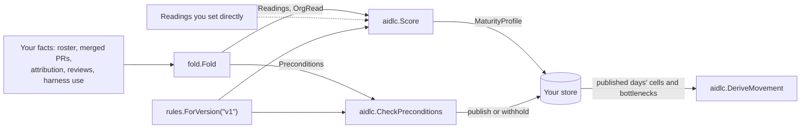

# aidlc

Teams that want to know how far AI has reached each stage of how they build software are left with surveys, which report what people believe rather than what their pull requests, sessions and reviews show, and do not say what holds a stage back. `aidlc` reads those delivery records into an AI development lifecycle (AIDLC) maturity grid that places each stage on a level of AI autonomy, names what holds it back, and says why when the records cannot decide a level, as the quick start shows for the review stage.

## Contents

- [What it does](#what-it-does) lists the entry points and how they fit together.
- [Quick start](#quick-start) scores two readings in a short complete program.
- [Choosing an entry point](#choosing-an-entry-point) maps what you have to the call to make.
- [Usage](#usage) shows each entry point in a complete program.
- [Reference](#reference) gives the grid, the decision order, the facts the fold reads and the ruleset's numbers.
- [Before you rely on it](#before-you-rely-on-it) lists where a profile can mislead, most harmful first.
- [Project](../README.md#project), at the repository root, covers versioning, tests, contributing, security and the license.

## What it does

The grid's stages are product spec, tech spec, plan, code, review, test and QA, CI/CD, deploy and operate. Its levels run from L1, where a person does the work and an assistant helps on request, to L5, where agents coordinate the work under the organisation's own policy.

Each of the 45 cells is met (established or emerging), not reached, or not yet visible. A cell the data cannot decide says why, and is never read as a zero.

Two terms recur below. A seat holder is a person on the organisation's AI-tool roster. A harness artifact is a skill, agent or command in that tool's setup, and a review artifact is a harness artifact that serves review.

| Call | What it does |
|---|---|
| `aidlc.Score(rs, rd, org, generatedAt) *Result` | Scores one organisation's readings and returns the `aidlcv1.MaturityProfile`, with the scored cells, stage verdicts and ranked bottlenecks behind it. |
| `fold.Fold(f fold.Facts) fold.Result` | Turns an organisation's raw facts into the readings and org-level reads `Score` takes. `fold.Facts` holds every fact it reads, documented field by field on pkg.go.dev, and [fold.Facts](#foldfacts) gives the rules that surprise people. |
| `aidlc.CheckPreconditions(rs, pre)` | Says whether a profile may be published. A window with no merged pull request, or with too few carrying a file list, is withheld. |
| `aidlc.DeriveMovement(snaps, cells, from, to, historyFrom)` | Reads week-over-week movement from the days you stored. |
| `aidlc.ResolveAdoptionState(orgCreatedAt, asOf, last30, prior30)` | Reads whether the deployment is onboarding, growing, steady, contracting or lapsed. `last30` and `prior30` are the active engineers in the last thirty days and in the thirty days before. |
| `rules.ForVersion("v1")`, `rules.DeclarationEffects(rs)` | Returns a copy of the frozen ruleset, and lists which cells each admin declaration opens. |

Every function is stateless. None reads a file, the clock or the network. The program that calls them supplies the facts, chooses the window, and stores the profiles.

### How it fits together



### What it does not do

- It does not fetch anything. Session attribution comes from [`attribution`](../attribution/), in this repository, or your own matcher. Pull requests and reviews come from your VCS data.
- By design, it reads no CI command outcomes and no deploy events.
- It does not decide the two judgment cells, plan L1 and test and QA L1. They always abstain.
- It does not compare organisations. A profile reads one organisation against the ruleset, never against a cohort.

## Quick start

You need Go 1.25.2 or newer, and nothing else: no service, account or credential. Start a module. The `go get` line resolves once v0.1.0 is tagged.

```sh
mkdir try-aidlc && cd try-aidlc && go mod init example.com/try
go get github.com/tetriz-ai/tetriz-engineering-intelligence@v0.1.0
```

Save this as `main.go`.

```go
// Command score-maturity-readings scores one organisation's readings and prints the
// review row of its AIDLC maturity map.
package main

import (
	"fmt"

	"github.com/tetriz-ai/tetriz-engineering-intelligence/aidlc"
	"github.com/tetriz-ai/tetriz-engineering-intelligence/aidlc/rules"
	aidlcv1 "github.com/tetriz-ai/tetriz-engineering-intelligence/gen/aidlc/v1"
)

func main() {
	seats, users := 20.0, 14
	reviewers := float64(users)
	rd := aidlc.NewReadings()
	rd.Set(aidlcv1.SignalKey_SIGNAL_KEY_SEAT_HOLDERS, aidlcv1.AidlcStage_AIDLC_STAGE_UNSPECIFIED, aidlc.Reading{Value: &seats})
	rd.Set(aidlcv1.SignalKey_SIGNAL_KEY_REVIEW_HARNESS_SEAT_HOLDERS, aidlcv1.AidlcStage_AIDLC_STAGE_REVIEW, aidlc.Reading{Value: &reviewers, People: &users})

	res := aidlc.Score(rules.ForVersion("v1"), rd, aidlc.OrgRead{}, nil)
	fmt.Println(res.Profile.GetSummary())
	for _, st := range res.Profile.GetStages() {
		if st.GetStage() != aidlcv1.AidlcStage_AIDLC_STAGE_REVIEW {
			continue
		}
		for _, c := range st.GetCells() {
			fmt.Println(c.GetLevel(), c.GetState(), c.GetAbstainKind())
		}
	}
}
```

`People` is how many distinct people stand behind a count. A cell abstains when too few people did the thing. `SEAT_HOLDERS` is set on `AIDLC_STAGE_UNSPECIFIED` because it is org-level: every stage reads the same roster. Run it.

```sh
go mod tidy && go run .
```

```text
In Review, a person does the work and an assistant helps on request. Nothing could be measured in Product spec, Tech spec, Plan, Code, Test & QA, CI/CD, Deploy and Operate.
AIDLC_LEVEL_L1 CELL_STATE_MET ABSTAIN_KIND_UNSPECIFIED
AIDLC_LEVEL_L2 CELL_STATE_NOT_YET_VISIBLE ABSTAIN_KIND_GAP
AIDLC_LEVEL_L3 CELL_STATE_NOT_YET_VISIBLE ABSTAIN_KIND_GAP
AIDLC_LEVEL_L4 CELL_STATE_NOT_YET_VISIBLE ABSTAIN_KIND_GAP
AIDLC_LEVEL_L5 CELL_STATE_NOT_YET_VISIBLE ABSTAIN_KIND_GAP
```

Fourteen of twenty seat holders used a review artifact, so review L1 is met. Nothing measured review L2 to L5, so each abstains with a gap rather than reading as not reached, and the summary names the stages nothing measured.

## Choosing an entry point

| You have | Use | Example |
|---|---|---|
| Counts per signal, from your own queries | [`Score` over `Readings` you set](#score-readings) | [score-maturity-readings](../examples/score-maturity-readings/) |
| Raw events: roster, pull requests, sessions, reviews | [`fold.Fold`, then `Score`](#fold-raw-facts) | [fold-team-facts](../examples/fold-team-facts/) |
| Harness artifacts with no stage yet, for `fold.Facts.StageMap` | [`stageclient.BuildStageMap`](#build-the-stage-map-with-model-service) against a running model-service | [`stageclient`'s `Example`](stageclient/client_test.go) |
| Any profile you will show people | [`CheckPreconditions`](#withhold-a-profile), before you publish | [withhold-a-thin-window](../examples/withhold-a-thin-window/) |
| Profiles stored day by day | [`DeriveMovement` and `ResolveAdoptionState`](#read-movement) | [track-movement](../examples/track-movement/) |

## Usage

### Score readings

When: you already count each signal, and want the map.

The quick start above is the complete program. Set each reading with `Readings.Set(signal, stage, reading)`. The scorer falls back to the org-level reading for any stage that has none of its own.

Remember:

- A signal you never set is a gap, not a zero. Set a zero only when you read the data and found none.
- When you saw only part of a population, say so with `Coverage`, `RemainderDeclared` and `RemainderValue`. The share becomes an interval, and a cell whose interval crosses a cut abstains rather than guess.
- `Score` does not check whether the window can support a profile. Run [`CheckPreconditions`](#withhold-a-profile) before you show one.
- `rules.ForVersion` returns nil for an unknown version, and `Score` panics on nil. Check it when the version comes from config.

### Fold raw facts

When: you hold events rather than counts. Eight people merge forty feature pull requests, and an AI session authored thirty of them in three human turns each.

```go
package main

import (
	"fmt"

	"github.com/tetriz-ai/tetriz-engineering-intelligence/aidlc"
	"github.com/tetriz-ai/tetriz-engineering-intelligence/aidlc/fold"
	"github.com/tetriz-ai/tetriz-engineering-intelligence/aidlc/rules"
	aidlcv1 "github.com/tetriz-ai/tetriz-engineering-intelligence/gen/aidlc/v1"
)

func main() {
	facts := fold.Facts{
		Attribution: fold.Attribution{AuthoredPRKeys: map[string]struct{}{}},
		HumanTurns:  map[string]int{},
	}
	for n := 0; n < 40; n++ {
		person := fmt.Sprintf("person-%d", n%8)
		key := fmt.Sprintf("acme/api#%d", n)
		if n < 8 {
			facts.Roster = append(facts.Roster, person)
		}
		facts.MergedPRs = append(facts.MergedPRs, fold.MergedPR{
			PRKey: key, AuthorIdentityID: &person, AuthorSeatLinked: true,
			WorkType: aidlcv1.PRWorkType_PR_WORK_TYPE_FEATURE,
			Paths:    []string{"api/handler.go"}, HasFileList: true,
		})
		if n < 30 {
			facts.Attribution.AuthoredPRKeys[key] = struct{}{}
			facts.HumanTurns[key] = 3
		}
	}

	folded := fold.Fold(facts)
	rs := rules.ForVersion("v1")
	_, withheld := aidlc.CheckPreconditions(rs, folded.Preconditions)
	fmt.Println("withheld by:", withheld)
	res := aidlc.Score(rs, folded.Readings, folded.Org, nil)
	for _, c := range res.Cells {
		if c.Stage == aidlcv1.AidlcStage_AIDLC_STAGE_CODE {
			fmt.Println(c.Level, c.State, c.Band, c.AbstainKind())
		}
	}
}
```

```text
withheld by: PRECONDITION_KEY_UNSPECIFIED
AIDLC_LEVEL_L1 CELL_STATE_MET PREVALENCE_BAND_ESTABLISHED ABSTAIN_KIND_UNSPECIFIED
AIDLC_LEVEL_L2 CELL_STATE_MET PREVALENCE_BAND_UNSPECIFIED ABSTAIN_KIND_UNSPECIFIED
AIDLC_LEVEL_L3 CELL_STATE_MET PREVALENCE_BAND_UNSPECIFIED ABSTAIN_KIND_UNSPECIFIED
AIDLC_LEVEL_L4 CELL_STATE_MET PREVALENCE_BAND_ESTABLISHED ABSTAIN_KIND_UNSPECIFIED
AIDLC_LEVEL_L5 CELL_STATE_NOT_YET_VISIBLE PREVALENCE_BAND_UNSPECIFIED ABSTAIN_KIND_GAP
```

Thirty of forty pull requests are AI-authored in three turns, so code L1 and L4 are established. L2 and L3 have no reading of their own here, so each is met only because L4 above it is. [fold-team-facts](../examples/fold-team-facts/) folds a fuller team.

Remember:

- A `PRKey` listed more than once is one pull request. The first occurrence is read.
- Put only the session matches you trust in `Attribution.AuthoredPRKeys`. Every AI-authored level reads it.

### Build the stage map with model-service

When: you have the organisation's skills, agents and commands, and need `fold.Facts.StageMap`, the stage each one serves.

[`aidlc/stageclient`](stageclient/) asks [model-service](../model-service/README.md#classify-harness-artifacts-into-aidlc-stages) to classify them: Gemini reads each artifact's name, and its body when you pass one, three times in differently mixed batches of 25, and a stage two of the three agree on is the verdict. Start the model server with your `GEMINI_API_KEY`, then:

```go
client := stageclient.NewClient("http://localhost:8000")
stageMap, err := client.BuildStageMap(ctx, artifacts) // []stageclient.Artifact{{ID, Name, Type, Body}, ...}
if err != nil { /* unreachable, a 5xx or 503, or an answer it could not read */ }
facts.StageMap = stageMap
```

Remember:

- Only a verdict enters the map. No majority, a failed call, or a type other than skill, agent or command leaves the artifact out, so it reads as unknown; it is never mapped to `AIDLC_STAGE_UNSPECIFIED`, which says it serves no stage.
- Copies of one artifact (each person's install of the same skill) with the same type, name, description and body are sent once and all get that one verdict, as the production classifier reuses one verdict per distinct artifact. Copies whose bodies differ are classified separately.
- The batches match the production classifier's within one request, up to 250 distinct artifacts. A larger set is split into requests of 250, and each request shuffles its own artifacts, so batches then differ from a single production sweep over the whole set.
- The same input gets the same batches, so labels are stable from call to call except for rare variation in the model itself: one verdict can flip between two identical calls.
- A description or body longer than 50,000 characters is cut to that length before it is sent.
- Send one organisation's artifacts per call: batch neighbours inform each answer.
- Each call is billed to your Gemini key: three model calls per batch of 25.

### Withhold a profile

When: the window may be too thin.

```go
// Command withhold-a-thin-window checks the preconditions for two windows: one with
// no merged pull request, and one where most pull requests carry no file list. Both
// withhold the profile, each for its own reason.
package main

import (
	"fmt"

	"github.com/tetriz-ai/tetriz-engineering-intelligence/aidlc"
	"github.com/tetriz-ai/tetriz-engineering-intelligence/aidlc/fold"
	"github.com/tetriz-ai/tetriz-engineering-intelligence/aidlc/rules"
	aidlcv1 "github.com/tetriz-ai/tetriz-engineering-intelligence/gen/aidlc/v1"
)

func main() {
	rs := rules.ForVersion("v1")

	// A quiet window: two seat holders, nothing merged.
	quiet := fold.Fold(fold.Facts{Roster: []string{"person-01", "person-02"}})
	report("quiet window", rs, quiet.Preconditions)

	// A window whose connector could not list the files of 7 of its 10 pull requests.
	var prs []fold.MergedPR
	for n := 0; n < 10; n++ {
		author := fmt.Sprintf("gh-person-%02d", n%3)
		prs = append(prs, fold.MergedPR{
			PRKey: fmt.Sprintf("acme/api#%d", 200+n), AuthorIdentityID: &author,
			HasFileList: n < 3, BaseBranch: "main",
		})
	}
	thin := fold.Fold(fold.Facts{MergedPRs: prs})
	report("thin window", rs, thin.Preconditions)
}

func report(name string, rs *rules.RuleSet, pre aidlc.Preconditions) {
	checks, withheld := aidlc.CheckPreconditions(rs, pre)
	fmt.Println(name)
	for _, c := range checks {
		fmt.Printf("  %-36s passed=%-5v %s\n", c.GetKey(), c.GetPassed(), c.GetDetail())
	}
	if withheld == aidlcv1.PreconditionKey_PRECONDITION_KEY_UNSPECIFIED {
		fmt.Println("  published")
		return
	}
	fmt.Println("  withheld by", withheld)
}
```

```text
quiet window
  PRECONDITION_KEY_NO_SEATED_ACTIVITY  passed=false 0 merged pull requests in the last 90 days
  PRECONDITION_KEY_PATH_COVERAGE       passed=true  1.00 of 0 merged pull requests carry a file list; a profile needs at least 0.80
  withheld by PRECONDITION_KEY_NO_SEATED_ACTIVITY
thin window
  PRECONDITION_KEY_NO_SEATED_ACTIVITY  passed=true  10 merged pull requests in the last 90 days
  PRECONDITION_KEY_PATH_COVERAGE       passed=false 0.30 of 10 merged pull requests carry a file list; a profile needs at least 0.80
  withheld by PRECONDITION_KEY_PATH_COVERAGE
```

`CheckPreconditions` returns every check and the key of the first that failed. An empty window fails first, because path coverage over zero pull requests reads as 1.00. `Score` ignores the preconditions, so you decide whether to show a withheld profile.

### Read movement

When: you store each day's profile and want the weekly story.

```go
// Command track-movement scores four weekly readings of the code stage, stores each
// week's cells and bottlenecks the way a caller would, and derives the movement series
// from them. It then reads the deployment's adoption state.
package main

import (
	"fmt"
	"time"

	"github.com/tetriz-ai/tetriz-engineering-intelligence/aidlc"
	"github.com/tetriz-ai/tetriz-engineering-intelligence/aidlc/rules"
	aidlcv1 "github.com/tetriz-ai/tetriz-engineering-intelligence/gen/aidlc/v1"
)

func main() {
	rs := rules.ForVersion("v1")
	code := aidlcv1.AidlcStage_AIDLC_STAGE_CODE
	firstFriday := time.Date(2026, 3, 6, 0, 0, 0, 0, time.UTC)

	// The share of the code stage's 180 pull requests that an assistant helped author,
	// read on the Friday of each week, by six people.
	var snaps []aidlc.MovementSnapshotRow
	var cells []aidlc.MovementCellRow
	for week, aiPRs := range []float64{20, 60, 110, 115} {
		day := firstFriday.AddDate(0, 0, 7*week)
		pop, people := 180.0, 6
		rd := aidlc.NewReadings()
		rd.Set(aidlcv1.SignalKey_SIGNAL_KEY_AI_ATTRIBUTED_MERGED_PRS, code, aidlc.Reading{Value: &aiPRs, People: &people})
		rd.Set(aidlcv1.SignalKey_SIGNAL_KEY_CODE_SEAT_LINKED_ARTIFACTS, code, aidlc.Reading{Value: &pop})
		res := aidlc.Score(rs, rd, aidlc.OrgRead{}, nil)

		snaps = append(snaps, aidlc.MovementSnapshotRow{AsOfDate: day, Published: true, Bottlenecks: res.Profile.GetBottlenecks()})
		for _, c := range res.Cells {
			row := aidlc.MovementCellRow{AsOfDate: day, Stage: c.Stage, Level: c.Level, State: c.State, Band: c.Band}
			if c.Share != nil {
				row.HasShare, row.ShareLow, row.ShareHigh = true, c.Share.Lo, c.Share.Hi
			}
			cells = append(cells, row)
		}
	}

	last := firstFriday.AddDate(0, 0, 21)
	for _, p := range aidlc.DeriveMovement(snaps, cells, firstFriday, last, firstFriday) {
		if p.GetStage() != aidlcv1.AidlcStage_AIDLC_STAGE_UNSPECIFIED && p.GetStage() != code {
			continue
		}
		fmt.Println(p.GetWeekStart(), p.GetKind(), p.GetStage(), p.GetLevel(), "held", p.GetWeeksHeld())
	}

	orgCreated := time.Date(2025, 11, 1, 0, 0, 0, 0, time.UTC)
	fmt.Println(aidlc.ResolveAdoptionState(orgCreated, last, 14, 10))
}
```

```text
2026-03-02 MATURITY_MOVEMENT_KIND_HISTORY_STARTS AIDLC_STAGE_UNSPECIFIED AIDLC_LEVEL_UNSPECIFIED held 0
2026-03-23 MATURITY_MOVEMENT_KIND_MOVED_UP AIDLC_STAGE_CODE AIDLC_LEVEL_L1 held 2
MATURITY_ADOPTION_STATE_GROWING
```

Store each day's `Result.Cells` as `MovementCellRow`s and the profile's bottlenecks as a `MovementSnapshotRow`, with `Published` false for a withheld day. `DeriveMovement` reads only the cells of days a snapshot marks published. It reports one point per change per ISO week, over at most 12 weeks.

| Kind | When |
|---|---|
| `MOVED_UP` | A cell rose and held for two weeks. |
| `MOVED_DOWN` | A cell fell from met to not reached, the week it is measured. |
| `LOST_SIGHT` | A cell that was visible abstains. |
| `COVERAGE_GAINED` | A cell's share interval narrowed week over week. |
| `STUCK` | A bottleneck was present in each of the last three or more weeks. |
| `HISTORY_STARTS` | The series begins inside the range, or is too short to read. |

`ResolveAdoptionState` sets the profile's `AdoptionState`, which `Score` leaves unset.

Every exported name is documented on [pkg.go.dev](https://pkg.go.dev/github.com/tetriz-ai/tetriz-engineering-intelligence/aidlc), and [examples/README.md](../examples/README.md) lists the runnable examples.

## Reference

### The grid

| Level | Meaning |
|---|---|
| L1 assisted | A person does the work, and an assistant helps on request. |
| L2 conversational | The work is worked out in dialogue with an assistant. |
| L3 supervised agentic | An agent produces a complete piece of work, and a person checks and approves it. |
| L4 autonomous | An agent completes the work unattended, and a person checks the result afterward. |
| L5 orchestrated | Agents coordinate the work under the organisation's own policy. |

Of the 45 cells, 36 are decided by a share of people or merged pull requests, though test and QA L4, CI/CD L4 and deploy L4 always abstain without CI or deploy outcomes. Two are implied floors (code L2, review L2), awarded when a higher level on the stage is met. Two are judgments the engine does not make. The other 5 cannot be measured from the facts the fold reads. [The method](../docs/aidlc/method.md) lists every cell's measure.

### How a cell is decided

A share cell divides a numerator by a population and bands the share:

- **Established** when the interval's low end is above 0.50.
- **Emerging** when the low end is above 0.20 and the high end is at or below 0.50.
- **Not reached** when the high end is at or below 0.20.
- **Not yet visible** (abstains) when the interval crosses a cut, or the population is under its floor (5 people, or 20 merged pull requests). It also abstains when too few distinct people did the thing (2 on most cells), or when a reading is missing or invalid.

Several cells check a control before they decide: the same stage's review rate on work without AI. When that rate is zero, a missing review on AI work says nothing, so the cell abstains. [The method](../docs/aidlc/method.md) says which cells carry one.

Downward closure then awards an undecided rung beneath a met one, and stops at any measured miss. The profile reports each stage's frontier, its highest established level.

### Whose it is: Ours and Yours

A cell's reason starts with whose it is to change. "Ours" is whoever runs the measurement: the caller's pipeline, which supplies the facts. "Yours" is the organisation being scored, which acts by declaring a review policy or enforcing a practice.

### fold.Facts

`fold.Fold` reads one `fold.Facts` per organisation and window. A zero field reads as "nothing of this kind", or as unreadable where its comment says so. `Fold` never errors.

- `StageMap` maps a harness artifact to the stage it serves. An artifact missing from the map counts as unread. That widens the share interval of every level that counts artifact use, and can make those cells abstain. Map it to `AIDLC_STAGE_UNSPECIFIED` to say it serves none.
- Hooks, rules, prompt templates, plugins and permissions are installed configuration. They never count toward a level, however often they fire. Skills, agents and commands do.
- A pull request missing from `HumanTurns`, or mapped to zero, is unread on the low-turn levels, not counted as high-turn.
- A pull request with no work type could be delivery, so it widens code's and test and QA's populations alike.
- Set `PlanningRead.PlannedPRKeysUnread` when the planned set could not be read, and `PRReviewFacts.ApprovalsUnread` when a review record's approvals were not captured. Both default to false, meaning read. When set, plan L3 and the declared review policy read those pull requests as unread, not as unplanned or unapproved.
- An invocation of an artifact the stage map does not name is unread. A presence level with none counted never reads not reached: it abstains on coverage, which closure can award, when its unread people make the share straddle a cut, and instrumented-only otherwise, after the floors. A non-zero count on these signals is a measured share and can read not reached; only a zero never denies.
- A reading nothing produced can carry a `Note`. The cell then gives it as its reason, "Ours: <note>.", so write it as a lower-case clause.
- The roster counts each person once. An invocation by someone not on it is dropped, and an empty id is never a person. `MergedPR.AuthorSeatLinked` is yours: it is not checked against the roster. Paths, branches and titles are matched whatever their case.
- A pull request with an empty `PRKey` joins nothing. It counts in its populations, and its AI authorship, turns and reviews are unread. Its author is in neither adoption count unless another of their pull requests is AI-authored.

### The ruleset

`rules.ForVersion("v1")` is the one released ruleset, and `rs.Hash()` is a digest over all of it. Store it with each profile to tell which ruleset scored it.

| Parameter | v1 |
|---|---|
| Window | 90 days |
| Band cuts | 0.50 and 0.20 |
| Population floors | 5 people, or 20 merged pull requests |
| Path coverage | 0.80 |

A released ruleset is never edited.

## Before you rely on it

Check these before you put a profile in front of people. Each is pinned by the test named with it.

### Verdicts

**Credits a level more than the data shows (can mislead):**

- Some cells measure a narrower stand-in than their level's definition. The L5 cells read the use of an admin-enforced practice, plan L3 and L4 read planning inside an AI session, and deploy reads merges into a branch whose role is shipped. The profile serves the stand-in's wording for those cells. Pinned in `aidlc/profile_test.go`, `TestPracticePhrase_MatchesStandIn`.
- An implied floor (code L2, review L2) is met with no measure of its own whenever a higher level on the stage is met. Pinned in `aidlc/scorer_test.go`, `TestFixtureA_RichCodeReviewStalledDeploy`.
- Downward closure meets an undecided cell beneath a met one, even a cell that abstained for a missing control, like code L3 in [Fold raw facts](#fold-raw-facts). Pinned in `aidlc/readings_guard_test.go`, `TestClosure_AwardsAnUndecidedCellBeneathAMetOne`.
- The emerging cut of 0.20 has no cohort behind it. A cell it decides says so. Pinned in `aidlc/rules/registry_test.go`, `TestBandCutsAndFloors`.

**Leaves a level unread (less harmful):**

- Test and QA L4, CI/CD L4 and deploy L4 always abstain, because the input carries no CI or deploy outcomes (see [What it does not do](#what-it-does-not-do)). Pinned in `aidlc/fold/fold_policy_test.go`, `TestFoldDeclaredCommands` and `TestFoldDeploy`.
- A share of exactly 0.50 is emerging, not established, and a people count one under a cell's floor abstains. Pinned in `aidlc/boundaries_test.go`, `TestBandBoundaries_ExactlyOnTheCuts`.
- A pull request whose source cannot flag a review bot is left out of both sides of every bot share. Pinned in `aidlc/fold/fold_test.go`, `TestFoldReviewBots_UnsupportedSourceLeftOut`.

### Bottlenecks

**Raises a constraint it should not (can mislead):** none known.

**Misses or understates a constraint (less harmful):**

- The review-reach bottleneck needs a recorded code L3 share. It fires only when that share stays under half even if every pull request with uncaptured reviewers counts as reviewed. Pinned in `aidlc/inputs_test.go`, `TestReviewReach_OnlyOnARecordedShare`.

### Movement

**Misses a fall (can mislead):**

- A cell that stays met but falls from established to emerging produces no movement point, while its rise back is reported as moved up. Moved down means met to not reached only, by design. Pinned in `aidlc/movement_rules_test.go`, `TestDeriveMovement_BandFallWithinMetIsNotReported`.

### Publishing

**Publishes when it should not (can mislead):** none known.

**Withholds when it need not (less harmful):**

- A profile is withheld when fewer than 80% of the window's merged pull requests carry a file list, even if the stages read from branches and sessions would have read well. Pinned in `aidlc/preconditions_test.go`, `TestCheckPreconditions`.
