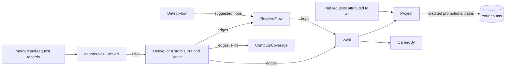

# branchlineage

In a repository where features merge into `develop` and reach `main` only through a promotion pull request, AI work credited to the feature pull requests never shows on `main`. `branchlineage` records which pull requests each promotion carried, so the promotion can be credited with that work and the chain behind the credit shown.

## Contents

- [What it does](#what-it-does) lists the entry points and how they fit together.
- [Quick start](#quick-start) credits a repository's promotions with the AI work they carried, in a short complete program.
- [Choosing an entry point](#choosing-an-entry-point) maps what you have to the call to make.
- [Usage](#usage) shows each entry point in a complete program.
- [Reference](#reference) gives the exact rules, defaults and errors.
- [Before you rely on it](#before-you-rely-on-it) lists where credit can be wrong, most harmful first.
- [Project](../README.md#project), at the repository root, covers versioning, tests, contributing, security and the license.

## What it does

A promotion is a merged pull request whose head branch had itself received merges, such as `develop` merged into `main`. It is the carrier, and the pull requests it carried are the merges into its head branch since the previous promotion of the same pair of branches, a span called its window. Each carrier-to-carried link is an edge.

A hop is a (head, base) branch pair, and a flow is the set of hops credit follows. A tracked branch is one whose merges you count, and a seed is a pull request merged into one, where a walk starts.

- **`Derive(prs) (*Graph, error)`** reads each merged pull request's head branch, base branch, merge time, `FirstCommitAt` and, when known, its head and merge commit times, and returns each promotion's carried pull requests, with the window it read them from.
- **`ResolveFlow(in) Flow`** decides the promotion flow a repository's credit follows: a person's confirmed flow as given, or one inferred from detection and the derived edges, with back-merges and ambiguous pairs refused. `DetectFlow` suggests a flow from merge counts, and `ValidateFlow` checks a flow a person confirms.
- **`Walk(ctx, src, seeds, flow, limits) (WalkResult, error)`** follows the edges back from the pull requests merged into a tracked branch, never re-entering a branch, and says what its caps left out. `Project` calls it for you. Call `Walk` directly to read the edges, or what a cap left out, without attributing anything.
- **`Project(ctx, src, in) (Projection, error)`** credits every walked promotion whose carried work includes a pull request you attributed to AI, with the shortest chain behind each credit. `CarriedBy` lists the pull requests each promotion delivered.
- **`ComputeCoverage(prs, edges, flow, terminals, total) Coverage`** says how much of a tracked branch the merge path explains, and lists each promotion whose own changed lines its carried pull requests do not account for. That list is the warning that history is missing.
- **`store/memory` and `store/sqlite`** keep the edges incrementally. A late or corrected pull request makes the promotions it affects stale (`Invalidate`), and the next `Derive` re-derives only those.
- **`adapter/vcs`** turns a connector's merged pull-request records into `PR`s.
- **`store/storetest.RunConformance`** checks a store of your own against the rules both shipped stores pass.
- **`WithObserver(o)`** sends derive, walk and invalidation counts to your metrics.

The [quick start](#quick-start) shows the credit a promotion earns, and [Derive promotion edges](#derive-promotion-edges) shows a promotion carrying another promotion.

The engine does no I/O of its own, reads no clock and calls no network. `Walk` and `Project` read edges only through the edge source you pass, and the stores read and write only their own memory or file.

### How it fits together



### What it does not do

- It does not fetch pull requests. Pass the merged pull-request records your connector fetched through `adapter/vcs`.
- It reads no commits and no merge SHAs, only pull-request records. [Credit](#credit) lists what that misses.
- It does not attribute sessions to pull requests, or allocate credit to people and teams. The attribution package matches sessions, and who gets credit is the caller's call.
- It does not choose the tracked branches or confirm a flow. Both are the caller's input.

## Quick start

You need Go 1.25.2 or later, and nothing else. In a module of your own (`go mod init example`), add the package, save the program as main.go and run it. The `go get` line resolves once v0.1.0 is tagged.

```sh
go get github.com/tetriz-ai/tetriz-engineering-intelligence@v0.1.0
go mod tidy
go run .
```

```go
// Command project-ai-attribution credits each promotion with the AI work it carried to main.
package main

import (
	"context"
	"fmt"
	"log"
	"time"

	"github.com/tetriz-ai/tetriz-engineering-intelligence/branchlineage"
)

func main() {
	at := func(hour float64) time.Time {
		return time.Date(2026, 4, 2, 0, 0, 0, 0, time.UTC).Add(time.Duration(hour * float64(time.Hour)))
	}
	pr := func(n int, head, base string, hour float64) branchlineage.PR {
		return branchlineage.PR{Key: fmt.Sprint("PR-", n), Repository: "acme/shop", Number: n,
			HeadBranch: head, BaseBranch: base, MergedAt: at(hour)}
	}
	prs := []branchlineage.PR{
		pr(1, "feature/login", "develop", 1), pr(2, "feature/cart", "develop", 2),
		pr(4, "feature/search", "develop", 3), pr(5, "feature/fix", "main", 4),
		pr(6, "feature/docs", "main", 5), pr(10, "develop", "release", 6),
		pr(3, "feature/pay", "develop", 7), pr(11, "release", "main", 8),
		pr(12, "develop", "main", 9),
	}
	prs[8].FirstCommitAt = at(6.5) // PR-12's earliest commit came after PR-10 merged
	// The pull requests an AI coding session produced, as the attribution package
	// would report them.
	attributed := map[string]struct{}{"PR-1": {}, "PR-2": {}, "PR-3": {}, "PR-5": {}}

	g, err := branchlineage.Derive(prs)
	if err != nil {
		log.Fatal(err)
	}
	onMain := func(_, branch string) bool { return branch == "main" }
	seeds := branchlineage.TrackedSeeds(prs, onMain)
	proj, err := branchlineage.Project(context.Background(), g, branchlineage.ProjectInput{
		Seeds:      seeds,
		Flows:      map[string][]branchlineage.Hop{"acme/shop": {{Source: "develop", Target: "release"}, {Source: "release", Target: "main"}, {Source: "develop", Target: "main"}}},
		Attributed: attributed,
	})
	if err != nil {
		log.Fatal(err)
	}
	for _, c := range proj.Credits {
		fmt.Println("credit", c.Carrier, "via", c.Path)
	}

	before, after := 0, 0
	credited := map[string]bool{}
	for _, k := range proj.Keys() {
		credited[k] = true
	}
	for _, s := range seeds {
		_, ai := attributed[s.Carrier]
		if ai {
			before++
		}
		if ai || credited[s.Carrier] {
			after++
		}
	}
	fmt.Printf("merges into main credited with AI work: %d of %d directly, %d of %d with lineage\n", before, len(seeds), after, len(seeds))

	for _, p := range branchlineage.CarriedBy(proj.Walk, nil).Pairs {
		fmt.Println("landed", p.Carried, "by", p.LandedBy)
	}
}
```

```text
credit PR-10 via [PR-10 PR-1]
credit PR-11 via [PR-11 PR-10 PR-1]
credit PR-12 via [PR-12 PR-3]
merges into main credited with AI work: 1 of 4 directly, 3 of 4 with lineage
landed PR-1 by [PR-11]
landed PR-2 by [PR-11]
landed PR-3 by [PR-12]
landed PR-4 by [PR-11]
```

Four pull requests merged into `main`: `PR-5`, `PR-6`, `PR-11` and `PR-12`. Only `PR-5` is attributed directly, so 1 of 4 is credited, and with lineage `PR-11` (which carried `PR-1` and `PR-2`) and `PR-12` (which carried `PR-3`) are credited too. `PR-10` merged into `release`, not `main`, so the count leaves it out.

`FirstCommitAt` on `PR-12` stops it from re-carrying `PR-1`, `PR-2` and `PR-4`, which `PR-10` already promoted, so set it wherever your records have it.

## Choosing an entry point

| You have | Use | Example |
|---|---|---|
| A repository's merged pull requests | [`Derive`](#derive-promotion-edges) | [derive-promotion-edges](../examples/derive-promotion-edges/) |
| Derived edges, and the branches you track | [`DetectFlow`, `ResolveFlow`](#resolve-a-flow) | [resolve-a-merge-flow](../examples/resolve-a-merge-flow/) |
| Pull requests attributed to AI | [`Walk`, `Project`, `CarriedBy`](#credit-promotions) | [project-ai-attribution](../examples/project-ai-attribution/) |
| A tracked branch whose numbers look low | [`ComputeCoverage`](#check-coverage) | [check-coverage](../examples/check-coverage/) |
| Pull requests arriving over time | [`store/sqlite` or `store/memory`](#keep-the-edges-up-to-date) | [index-on-sqlite](../examples/index-on-sqlite/) |
| Edges to read, or what a cap cut, without crediting | [`Walk`](#walk) | [cap-a-walk](../examples/cap-a-walk/) |
| A connector's pull-request records | [`adapter/vcs.Convert`](#read-connector-records) | [attribute-across-promotions](../examples/attribute-across-promotions/) |

Every entry point takes pull requests by the key you give them, and compares keys exactly. Use the key the [`attribution`](../README.md#what-attribution-does) package matched (`PRMatch.GetPrKey()`) and the two join without a lookup.

## Usage

### Derive promotion edges

When: you have one or more repositories' merged pull requests and want to know what each promotion carried.

```go
// Command derive-promotion-edges derives which pull requests each promotion carried.
package main

import (
	"fmt"
	"log"
	"time"

	"github.com/tetriz-ai/tetriz-engineering-intelligence/branchlineage"
)

func main() {
	at := func(hour float64) time.Time {
		return time.Date(2026, 4, 2, 0, 0, 0, 0, time.UTC).Add(time.Duration(hour * float64(time.Hour)))
	}
	pr := func(n int, head, base string, hour float64) branchlineage.PR {
		return branchlineage.PR{Key: fmt.Sprint("PR-", n), Repository: "acme/shop", Number: n,
			HeadBranch: head, BaseBranch: base, MergedAt: at(hour)}
	}
	prs := []branchlineage.PR{
		pr(1, "feature/login", "develop", 1), pr(2, "feature/cart", "develop", 2),
		pr(4, "feature/search", "develop", 3), pr(5, "feature/fix", "main", 4),
		pr(6, "feature/docs", "main", 5), pr(10, "develop", "release", 6),
		pr(3, "feature/pay", "develop", 7), pr(11, "release", "main", 8),
		pr(12, "develop", "main", 9),
	}
	prs[8].FirstCommitAt = at(6.5) // PR-12's earliest commit came after PR-10 merged

	g, err := branchlineage.Derive(prs)
	if err != nil {
		log.Fatal(err)
	}
	for _, d := range g.Derivations() {
		if d.Outcome == branchlineage.OutcomeCarrier {
			fmt.Println(d.Carrier, d.Source+"->"+d.Target, "carried", carried(d))
		}
	}
}

func carried(d branchlineage.Derivation) []string {
	var out []string
	for _, e := range d.Edges {
		out = append(out, e.Carried)
	}
	return out
}
```

```text
PR-10 develop->release carried [PR-1 PR-2 PR-4]
PR-11 release->main carried [PR-10]
PR-12 develop->main carried [PR-3]
```

`PR-10`, the promotion of `develop` to `release`, carried the three features merged into `develop` before it. `PR-11` promoted `release` to `main` and carried `PR-10`, so a walk from `main` reaches the features through two hops.

`PR-12`'s earliest commit came after `PR-10` merged, so its window opens there and it carries only `PR-3`. Without `FirstCommitAt` it would read back 90 days and also carry `PR-1`, `PR-2` and `PR-4`.

`Derive` derives every merged pull request. `NewHistory` and `History.Derive` derive one at a time, and each `Derivation` carries its `Outcome` and the `Evidence` of how its window was bounded.

Remember:

- A pull request is carried by a promotion only if it merged into the promotion's head branch inside its window. Head branch, base branch, merge time and, when you set them, `FirstCommitAt`, `HeadCommitAt` and `MergeCommitAt` are the whole input.
- Set `FirstCommitAt`, and `HeadCommitAt` and `MergeCommitAt` together, wherever your records have them. [Credit](#credit) says what is over-credited without them.

### Resolve a flow

When: you need the set of hops a repository's credit should follow.

```go
package main

import (
	"fmt"
	"log"
	"time"

	"github.com/tetriz-ai/tetriz-engineering-intelligence/branchlineage"
)

func main() {
	var prs []branchlineage.PR
	for i, hop := range [][2]string{
		{"feature/login", "develop"}, {"develop", "main"}, {"feature/cart", "develop"},
		{"develop", "main"}, {"main", "develop"}, {"feature/search", "develop"},
	} {
		prs = append(prs, branchlineage.PR{Key: fmt.Sprint("PR-", i+1), Repository: "acme/shop", Number: i + 1,
			HeadBranch: hop[0], BaseBranch: hop[1], MergedAt: time.Date(2026, 4, 2, i, 0, 0, 0, time.UTC)})
	}
	suggested := branchlineage.DetectFlow(branchlineage.MergePairs(prs), nil)
	fmt.Println("suggested", suggested.Hops, "valid:", branchlineage.ValidateFlow(suggested.Hops) == nil)

	g, err := branchlineage.Derive(prs)
	if err != nil {
		log.Fatal(err)
	}
	flow := branchlineage.ResolveFlow(branchlineage.FlowInput{
		DetectedHops: suggested.Hops,
		EdgePairs:    branchlineage.EdgePairs(g.Edges()),
		Tracked:      map[string]struct{}{"main": {}},
	})
	fmt.Println(flow.Origin, flow.Hops, "terminals", flow.Terminals)
}
```

```text
suggested [develop->main] valid: true
inferred [develop->main] terminals [main]
```

`develop`->`main` merged twice and `main`->`develop` once, so `DetectFlow` keeps the dominant direction. No flow was confirmed, so `ResolveFlow` returns it as `inferred`, ending at the tracked `main`.

Remember:

- With no tracked branches the edges are ignored, so pass `Tracked` whenever you have it.
- A hop recorded in both directions is refused, with everything behind it. Pass the flow a person decided as `ConfirmedHops` with `Confirmed: true`, and `Origin` says it is confirmed. A confirmed flow with no hops is an explicit off switch.

### Credit promotions

When: you have the pull requests the `attribution` package matched to AI sessions and want the promotions that carried them to the tracked branch credited too.

```go
package main

import (
	"context"
	"fmt"
	"log"
	"time"

	"github.com/tetriz-ai/tetriz-engineering-intelligence/branchlineage"
)

func main() {
	at := func(hour int) time.Time { return time.Date(2026, 4, 2, hour, 0, 0, 0, time.UTC) }
	prs := []branchlineage.PR{
		{Key: "PR-1", Repository: "acme/shop", Number: 1, HeadBranch: "feature/login", BaseBranch: "develop", MergedAt: at(1)},
		{Key: "PR-2", Repository: "acme/shop", Number: 2, HeadBranch: "feature/cart", BaseBranch: "develop", MergedAt: at(2)},
		{Key: "PR-3", Repository: "acme/shop", Number: 3, HeadBranch: "develop", BaseBranch: "main", MergedAt: at(3)},
	}
	g, err := branchlineage.Derive(prs)
	if err != nil {
		log.Fatal(err)
	}
	proj, err := branchlineage.Project(context.Background(), g, branchlineage.ProjectInput{
		Seeds:      branchlineage.TrackedSeeds(prs, func(_, branch string) bool { return branch == "main" }),
		Flows:      map[string][]branchlineage.Hop{"acme/shop": {{Source: "develop", Target: "main"}}},
		Attributed: map[string]struct{}{"PR-2": {}},
	})
	if err != nil {
		log.Fatal(err)
	}
	for _, c := range proj.Credits {
		fmt.Println("credit", c.Carrier, "via", c.Path)
	}
	for _, p := range branchlineage.CarriedBy(proj.Walk, nil).Pairs {
		fmt.Println("landed", p.Carried, "by", p.LandedBy)
	}
}
```

```text
credit PR-3 via [PR-3 PR-2]
landed PR-1 by [PR-3]
landed PR-2 by [PR-3]
```

[project-ai-attribution](../examples/project-ai-attribution/) runs this on a two-hop repository and counts the tracked branch before and after.

Remember:

- Count only the credits whose carrier is one of your seeds, as the quick start does. `Credits` also holds promotions into intermediate branches such as `release`.
- Check `Projection.Walk.DepthCapped` and `RouteCapped` before you trust a count.

### Check coverage

When: a tracked branch's attributed share looks too low, and you want to know whether the merge path explains its promotions.

```go
package main

import (
	"fmt"
	"log"
	"time"

	"github.com/tetriz-ai/tetriz-engineering-intelligence/branchlineage"
)

func main() {
	at := func(hour int) time.Time { return time.Date(2026, 4, 2, hour, 0, 0, 0, time.UTC) }
	prs := []branchlineage.PR{
		{Key: "PR-1", Repository: "acme/shop", Number: 1, HeadBranch: "feature/login", BaseBranch: "develop", MergedAt: at(1), LinesAdded: 120},
		{Key: "PR-2", Repository: "acme/shop", Number: 2, HeadBranch: "develop", BaseBranch: "main", MergedAt: at(2), LinesAdded: 130},
		{Key: "PR-3", Repository: "acme/shop", Number: 3, HeadBranch: "release/2.0", BaseBranch: "main", MergedAt: at(3), LinesAdded: 1400},
	}
	g, err := branchlineage.Derive(prs)
	if err != nil {
		log.Fatal(err)
	}
	flow := []branchlineage.Hop{{Source: "develop", Target: "main"}, {Source: "release/2.0", Target: "main"}}
	mergedIntoMain := 2
	cov := branchlineage.ComputeCoverage(prs, g.Edges(), flow, []string{"main"}, mergedIntoMain)
	fmt.Printf("carrier share %.2f, explained share %.2f\n", cov.CarrierShare, cov.ExplainedShare)
	for _, c := range cov.Unexplained() {
		fmt.Println("unexplained", c.Carrier, c.Band, "carried", c.CarriedSum, "lines")
	}
}
```

```text
carrier share 1.00, explained share 1.00
unexplained PR-3 zero_carried carried 0 lines
```

`PR-2`'s 130 lines fall within the 0.5x to 2x band of the 120 it carried, so it is explained. `release/2.0` was created with its content already on it, so `PR-3` carried nothing, and coverage, which counts every merge along the flow into `main`, lists it. A promotion that carried nothing leaves the explained share's denominator, so read `Unexplained`, not the share alone.

Remember:

- Pass one repository's pull requests and edges, restricted to the promotions merged in your reporting period, and count the total over the same period.
- A promotion with no line data is listed as unexplained too, with its band saying why.

### Keep the edges up to date

When: pull requests keep arriving, some late and some corrected, and re-deriving everything each time is wasteful.

```go
package main

import (
	"context"
	"fmt"
	"log"
	"time"

	"github.com/tetriz-ai/tetriz-engineering-intelligence/branchlineage"
	"github.com/tetriz-ai/tetriz-engineering-intelligence/branchlineage/store/sqlite"
)

func main() {
	ctx := context.Background()
	s, err := sqlite.Open(":memory:")
	if err != nil {
		log.Fatal(err)
	}
	defer func() { _ = s.Close() }()
	at := func(hour int) time.Time { return time.Date(2026, 4, 2, hour, 0, 0, 0, time.UTC) }
	if _, err := s.Put(ctx,
		branchlineage.PR{Key: "PR-1", Repository: "acme/shop", Number: 1, HeadBranch: "feature/login", BaseBranch: "develop", MergedAt: at(1)},
		branchlineage.PR{Key: "PR-3", Repository: "acme/shop", Number: 3, HeadBranch: "develop", BaseBranch: "main", MergedAt: at(3)},
	); err != nil {
		log.Fatal(err)
	}
	if _, err := s.Derive(ctx); err != nil {
		log.Fatal(err)
	}

	late := branchlineage.PR{Key: "PR-2", Repository: "acme/shop", Number: 2, HeadBranch: "feature/cart", BaseBranch: "develop", MergedAt: at(2)}
	inv, err := s.Put(ctx, late)
	if err != nil {
		log.Fatal(err)
	}
	fmt.Println("stale", inv.Keys())
	if _, err := s.Derive(ctx); err != nil {
		log.Fatal(err)
	}
	edges, err := s.EdgesFrom(ctx, []string{"PR-3"})
	if err != nil {
		log.Fatal(err)
	}
	for _, e := range edges {
		fmt.Println(e.Carrier, "->", e.Carried)
	}
}
```

```text
stale [PR-3]
PR-3 -> PR-1
PR-3 -> PR-2
```

[index-on-sqlite](../examples/index-on-sqlite/) adds a restart and a replay.

Remember:

- `Put` replaces a stored pull request whole. Merge partial records yourself before you put them.
- A store has one writer. Run one indexer per store.

### Read connector records

When: your pull requests come from a connector's merged-pull-request records.

```go
package main

import (
	"fmt"
	"log"
	"time"

	"github.com/tetriz-ai/tetriz-engineering-intelligence/branchlineage"
	"github.com/tetriz-ai/tetriz-engineering-intelligence/branchlineage/adapter/vcs"
)

func main() {
	day := time.Date(2026, 4, 2, 0, 0, 0, 0, time.UTC)
	prs := vcs.Convert([]vcs.Record{
		{ExternalID: "mr-41!7#merged", DataDate: day.Add(9 * time.Hour),
			Metadata: map[string]string{"repo": "acme/shop", "head_branch": "feature/search", "target_branch": "develop"}},
		{ExternalID: "mr-41!8#merged", DataDate: day.Add(15 * time.Hour),
			Metadata: map[string]string{"repo": "acme/shop", "head_branch": "develop", "target_branch": "main"}},
	})
	g, err := branchlineage.Derive(prs)
	if err != nil {
		log.Fatal(err)
	}
	for _, e := range g.Edges() {
		fmt.Println(e.Carrier, "carried", e.Carried)
	}
}
```

```text
mr-41!8#merged carried mr-41!7#merged
```

[attribute-across-promotions](../examples/attribute-across-promotions/) feeds one fetch to both this adapter and the `attribution` package's, and counts the result in the AIDLC fold.

Remember:

- `DataDate` is read as the merge time. Convert merged-pull-request records only.
- A record with no recognised base-branch key converts with an empty `BaseBranch`, and `Derive` reports it as `OutcomeDropped`. [adapter/vcs](#adaptervcs) lists the keys.

`go doc ./branchlineage` lists the full API, and [examples/README.md](../examples/README.md) lists every example.

## Reference

### Derive

A merged pull request with head branch `S` and base branch `T` is derived by these rules, in order.

| Rule | What it decides |
|---|---|
| Identifiable hop | No repository, a fork, a missing branch or `S` equal to `T` is `OutcomeDropped`. |
| Carrier test | `S` never received a merged pull request before it: `OutcomeNonCarrier`. |
| Window | It carries the merges into `S` after the previous non-fork merge of `S` into `T`, up to itself, less any the Head rule leaves out, plus any the previous promotion's head did not hold. |
| Cold start | With no previous one, the window opens at `FirstCommitAt`, or `ColdStartLookbackDays` (90) days before the merge, whichever is later. A first commit after the merge is ignored. |
| Head | With `HeadCommitAt` on the promotion and `MergeCommitAt` on a merge into `S`, a merge committed after the promotion's head commit was not in what it merged. It is not carried, and a later promotion of the pair whose head held it carries it instead. The head commit is compared with the merge commit, not with the merge time, because a merge commit is often dated seconds before its recorded merge; a merge commit dated after its merge counts at the merge. |
| Back-merge | A merge into `S` whose own head is `T` is never carried. |
| Result | An empty window is `OutcomeDerivedEmpty`. Otherwise it is `OutcomeCarrier`, with one `Edge` per carried pull request. |

- **Order:** merges are ordered by `MergedAt`, then `Number`, then `Key`. The promotion's own position is inside its window. A previous promotion's position is outside it, while a merge exactly at a cold-start bound (`FirstCommitAt` or the 90-day floor) is inside it.
- **Forks:** a fork's pull request is carried like any other, but is never a promotion or a window bound.
- **Lines:** an edge records both pull requests' `LinesAdded + LinesDeleted`, nil when both are zero.
- **Errors:** an empty or repeated key fails `NewHistory` and `Derive` with `ErrInvalidPR`, and so does `History.Derive` on a key that is missing or not merged.

### Invalidate

`Invalidate(before, incoming)` lists the derived promotions an incoming batch makes stale. Each incoming pull request replaces the stored one with its key whole.

| Reason | When |
|---|---|
| `ReasonCorrection` | A stored merged pull request's derivation inputs changed: it, and every promotion that carried it. |
| `ReasonLateLeaf` | A late pull request falls inside a derived promotion's window. For each branch its base is promoted to, the stale promotion is the first one merged at or after it, or, when commit times say its head did not hold the pull request, each later one whose head held it while the previous one's did not. |
| `ReasonLatePromotion` | A promotion now sits before another of the same pair, whose window it bounds. |

- **Unchanged:** a pull request delivered again with the same derivation inputs changes nothing. `OpenedAt` is not an input.
- **Unmerged:** a stored merged pull request replaced by an unmerged one leaves its window, and the promotion that carried it is stale.

### Walk

The walk starts at each seed and follows edges breadth-first.

- **Admitted:** an edge whose (source, target) hop is in the flow, and whose source branch is not already on the route. A route never re-enters a branch, which ends any cycle.
- **Repeats:** a pull request reached under one seed through two promotions keeps both edges. An exact repeat of (seed, carrier, carried) is emitted once.
- **Order:** seeds as given, and each promotion's edges by carried key, whatever order the source returns.

| Limit | Default | Rule |
|---|---|---|
| `MaxDepth` | 20 | Used as given. Zero or negative takes the default. Lineage deeper than it is not followed, and `DepthCapped` names the repository. |
| `MaxRoutes` | 50,000 | Used as given. Zero or negative takes the default. It is the walk's only memory bound, and the caller owns it. Past it the walk stops descending and sets `RouteCapped`. |

- **Cut nodes:** `Unexpanded` lists the pull requests whose own edges a cap left unfollowed. Under the depth cap, those are the ones with edges past it. Under the route cap, it is every node of the level where the budget ran out, and that level still emits all its edges.
- **Errors:** an error from the edge source fails the walk.

[cap-a-walk](../examples/cap-a-walk/) walks one chain under each cap and prints what the result and the Observer report.

### ResolveFlow

| Input | Result |
|---|---|
| `Confirmed` with hops | The hops as given, `OriginConfirmed`. |
| `Confirmed` with no hops | No flow. The repository attributes nothing. |
| Not confirmed | Detected hops and edge pairs, reduced together, `OriginInferred`. If the reduction keeps nothing, or there are no edge pairs, the detected hops stand, less any refused as ambiguous or as leaving a tracked branch. |

- **No reach:** `EdgesReachNoTrackedBranch` is set when no edge pair touches a tracked branch.

The reduction refuses three kinds of hop, and `Refused` reports the detected ones with their reason.

| Reason | The hop |
|---|---|
| `RefusedFlowsFromTrackedBranch` | Leaves a tracked branch for an untracked one: a back-merge. |
| `RefusedAmbiguousDirection` | Was recorded in both directions. Only a person can settle it. |
| `RefusedReachesNoTrackedBranch` | Never reaches a tracked branch. |

- **Terminals:** the tracked branches the flow reaches, or, when it reaches none, the targets that are never a source.
- **Observed:** the edge pairs that survived the reduction, reported whatever the confirmation state.

### DetectFlow and ValidateFlow

- **Support:** a direction needs `DetectionSupport` (2) merges, a fixed constant. `MergePairs` counts merged, non-fork pull requests per (head, base), with the first and last merge time.
- **Direction:** each pair of branches keeps its dominant direction. An equal split is dropped unless `FlowFacts` breaks it: a declared flow first, then the more recently updated branch.
- **Shape:** a cycle loses its weakest edge on the cycle. A hop into a terminal survives only if its source receives a merge from a branch other than that terminal no later than the hop's last merge. The result is one connected flow into one terminal, which `ValidateFlow` accepts.
- **Validation:** `ValidateFlow` rejects an empty or blank branch (whitespace-only, as `unicode.IsSpace` defines it), a branch promoted into itself, a repeated hop, a cycle and more than one terminal, wrapping `ErrInvalidFlow`. `TrackedBranchOnFlow` checks that a tracked entry, exact or a `path.Match` glob, matches some hop's target.

### Project and CarriedBy

- **Credit:** `Project` walks each repository's seeds through its flow and credits every walked promotion with a path to an attributed key. `Path` is the shortest chain, ties broken by the chain's keys in order.
- **No input:** no attributed keys, or no flow for a seed's repository, credits nothing.
- **Pairs:** `CarriedBy` lists a carried pull request as delivered under a seed when it has no visible child of its own there, so a promotion in the middle of a chain is not a pair.
- **Visible:** `CarriedBy`'s second argument reports whether a key is in what you are reporting, such as one month's merges. `nil` makes every key visible.
- **Unresolvable:** a pull request that is not visible, that only seeds outside the visible population landed, or that a cap cut under every seed that reached it, is counted in `Unresolvable` instead, each once. `LandedBy` lists the visible seeds under which it was expanded and found terminal.

### ComputeCoverage

Each merged, non-fork pull request in `prs` whose hop is in the flow and whose base is a terminal is a promotion here, whether or not it carried anything. Each falls in exactly one band.

| Band | When |
|---|---|
| `BandNoCarrierLines` | The promotion has no line data. |
| `BandNoCarriedLines` | A pull request it carried has no line data. |
| `BandZeroCarried` | It carried nothing, or its carried lines sum to zero. |
| `BandIn` | Its lines are 0.5 to 2 times the carried sum. |
| `BandOut` | Any other ratio. |

- **Shares:** `CarrierShare` is the promotions over your tracked-branch total. `ExplainedShare` is the in-band promotions over those not excluded by the first three bands.
- **No carriers:** `HasCarriers` is false for a repository that merges straight into its tracked branch, which is not 0% explained.
- **Warning:** `Unexplained` lists every promotion outside `BandIn`.

### The stores

- **Put:** records pull requests in one transaction (SQLite), drops the stale promotions' edges and queues them with every merged pull request not yet derived.
- **Derive:** re-derives the queue, replacing each promotion's edge set whole, one transaction per promotion in SQLite.
- **Reads:** a stale promotion reads as no edges until it is derived, never a mix of old and new.
- **Conformance:** both stores pass `store/storetest`. A store of your own that passes it is interchangeable with them.

### adapter/vcs

| Field | Read from |
|---|---|
| `Key` | `ExternalID` |
| `Repository` | `repo`, joined with `owner` when `repo` is bare |
| `Number` | `N` in a key like `acme/shop#PR-42#merged` or `mr-1234!7#merged`. Any other key gives 0. |
| `HeadBranch` | `head_branch` |
| `BaseBranch` | `base_ref_name`, `target_branch` or `destination_branch` |
| `MergedAt` | `DataDate` |
| `FirstCommitAt` | `first_commit_at`, RFC 3339 |
| `HeadCommitAt` | `head_commit_at`, RFC 3339: the committer date of the head commit merged |
| `MergeCommitAt` | `merge_commit_at`, RFC 3339: the committer date of the commit the merge put on the base branch |
| `OpenedAt` | The payload's `createdAt`, `created_at` or `created_on` |
| `LinesAdded`, `LinesDeleted` | The sums over `files_line_stats`, a JSON array of `{"additions":N,"deletions":N}`, such as `[{"additions":40,"deletions":10}]` |
| `CrossRepository` | `is_cross_repository` set to `true`, or the payload's `isCrossRepository` |

An unreadable field is left at its zero value instead of failing the record.

## Before you rely on it

Know these before you publish numbers this package produced. Each is pinned by a test, and an entry marked "Declined:" is behaviour kept on purpose.

### Credit

**Credits more than it should (can overstate AI work)**

- Every pull request merged into a promotion's head branch inside its window is carried, including one later reverted there: the package reads no commits (`TestDerive_ARevertIsCarriedLikeAnyMerge`).
- `Projection.Credits` includes promotions that never merged into a tracked branch themselves, such as one into `release` that a later promotion carried on. Count only the credits whose carrier is a seed (`TestScenario_NinePRPaths`).
- Without `FirstCommitAt`, a pair's first promotion reads back 90 days, so it also carries work another promotion pair, such as `develop->release`, already promoted, and both promotions are credited for it (`TestDerive_WithoutFirstCommitALaneRecarries`).
- Without `HeadCommitAt` on a promotion and `MergeCommitAt` on the merges into its head branch, a merge that landed after the promotion's last push, but before it merged, is carried. A pull request stacked onto a branch minutes before that branch's promotion is then credited to the promotion as well as to the one that delivered it (`TestProject_HeadCommitBoundsTheCredit`).
- Declined: a change merged into one branch and its cherry-picked copy merged into another are two pull requests, never linked, so the promotion that carries the copy credits it as new work (`TestDerive_CherryPickCopiesAreNotLinkedDeclined`).
- Declined: branches are known by name alone. A branch deleted and created again under the same name inherits the old one's merges inside the lookback, unless `FirstCommitAt` bounds the window (`TestDerive_BranchNameReuseDeclined`).
- Declined: a promotion is credited once and whole, however little of what it carried was attributed, and its credit names one chain. There is no fractional credit (`TestProject_OneCreditPerCarrierDeclined`).

**Credits less than it should (understates AI work)**

- Content a branch held when it was created, such as a release branch cut from `develop`, is not carried by any pull request. Coverage lists the promotion as unexplained (`TestComputeCoverage_ReleaseCutWithNoHotfix`, `TestComputeCoverage_GitFlowReleaseCut`).
- A pair's first promotion reads back at most `ColdStartLookbackDays` (90) days, a fixed constant, so older work on its head branch is not carried (`TestDerive_Rules`, `TestFixedConstants`).
- A hop recorded in both directions is refused in an inferred flow, and so is everything behind it (`TestForwardFlow`, `TestResolveFlow_RefusedReasons`).
- A capped walk stops short. The result says so through `DepthCapped`, `RouteCapped` and `Unexpanded` (`TestWalk_DepthCap`, `TestWalk_SmallRouteBudgetIsHonoured`).

### Flows

**Suggests a hop it should not**

- None known. A merge of the trunk into a feature branch does not make that branch a promotion source (`TestDetectFlow_ASyncFromTheTargetIsNoInboundMerge`).

**Misses a hop**

- A hop seen fewer than `DetectionSupport` (2) times, a fixed constant, is never suggested, and only the derived edges can add it to an inferred flow (`TestDetectFlow`, `TestResolveFlow`, `TestFixedConstants`).
