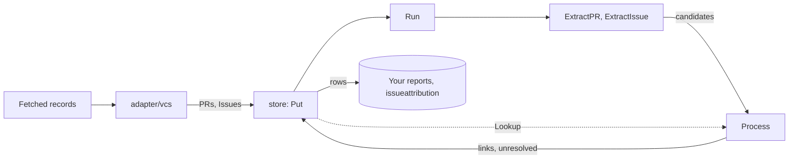

# issuelinkage

If you report which tracker issues your team's pull requests delivered, the references are scattered across titles, bodies, branch names and vendor link fields, and a plain key search counts every passing mention as delivery. `issuelinkage` resolves those references to the records you hold and keeps a closing link apart from a mention, with the evidence for each.

## Contents

- [What it does](#what-it-does) lists the entry points, how they fit together, and which vendors' links it reads.
- [Quick start](#quick-start) links one pull request to the issues it names, in a short complete program.
- [Choosing an entry point](#choosing-an-entry-point) maps what you have to the call to make.
- [Usage](#usage) shows each entry point in a complete program.
- [Reference](#reference) gives the exact rules, defaults, errors and the JSON contract.
- [Before you rely on it](#before-you-rely-on-it) lists where a link can be wrong, most harmful first.
- [Project](../README.md#project), at the repository root, covers versioning, tests, contributing, security and the license.

## What it does

A candidate is one reference found on a record, such as `PROJ-7` after "Fixes" in a pull request's body. A link folds every candidate on one record that names the same counterpart into one result. The result says whether the link is direct or a reference, how strong it is, whether it closes the issue, and which candidates back it.

- **`ExtractPR(pr, bareKeys, signals)` and `ExtractIssue(issue, signals)`** list a record's candidates from its title, body and branch name, and from the links the vendor records, each with the keyword before it and the heading it sits under. `bareKeys` names the tracker a bare key such as `PROJ-42` belongs to.
- **`Process(ctx, lookup, entity, extraction, now) (Result, error)`** resolves each candidate to a stored counterpart, folds them into links, and lists what did not resolve and why. On an issue it elects the closing pull request, the newest merge among the pull requests the issue's own evidence says close it. A pull request's own claim never wins.
- **`Run(ctx, store, now, cfg) (Report, error)`** processes every new or changed record, retries one whose counterpart may still arrive, and processes each newly linked counterpart once more so both sides settle. An issue whose own text names no pull request keeps no link on its row.
- **`store/memory` and `store/sqlite`** keep records and their rows. A changed record is processed again on the next run, and an unchanged one is not, so a rerun adds no work.
- **`adapter/vcs`** turns fetched pull-request and issue records into `PR` and `Issue` values.
- **`store/storetest.RunConformance`** checks a store of your own against the rules both shipped stores pass.

The [quick start](#quick-start) shows a closing link, a reference and a background mention side by side. The [`issueattribution`](../issueattribution/README.md) package turns the links into an issue-level AI share.

`ExtractPR`, `ExtractIssue` and `Process` keep no state. `Run` is stateful: each stored pull request or issue keeps a row with its latest result and status, and a put that adds or changes a record arms that row for the next run. Both take the clock as `now`, so a run is reproducible.

### How it fits together



### Vendor support

| Vendor | Links the vendor records | Text the engine scans |
|---|---|---|
| GitHub | Closing references both ways: a pull request's closing issues, an issue's closing pull requests | Titles, bodies, head branch |
| GitLab | A merge request's closed issues, when your record carries the `closes_issues` metadata | Titles, bodies, head branch, with `#N` and `group/project#N` read as GitLab issues |
| Linear | Pull-request attachments to GitHub and GitLab, as fetched, and `NativeRefsTruncated` reports when the vendor said more exist | Titles, bodies |
| Bitbucket | None | Titles, bodies, head branch |
| Jira | None | Titles, bodies, with an Atlassian Document Format description flattened to text |

`DefaultSignals` reads the vendor links above. Pass your own `SignalSet` in `Config.Signals` to read text only.

### What it does not do

- It does not fetch records, and it calls no network. Pass the records you fetched, through `adapter/vcs` or as `PR` and `Issue` values.
- It does not read commit messages, issue edit history or Jira's development panel.
- It does not decide whether a pull request was AI-assisted. [`issueattribution`](../issueattribution/README.md) combines the links with signals you supply.
- It does not judge a link true or false. It grades the evidence and reports what blocks a link.

## Quick start

You need Go 1.25.2 or later, and nothing else: no service, account or credential. Start a module. The `go get` line resolves once v0.1.0 is tagged.

```sh
mkdir try-issuelinkage && cd try-issuelinkage && go mod init example.com/try
go get github.com/tetriz-ai/tetriz-engineering-intelligence@v0.1.0
```

Save this as `main.go`.

```go
// Command link-a-pr-to-issues links a pull request to the tracker issues it names.
package main

import (
	"context"
	"fmt"
	"log"
	"time"

	"github.com/tetriz-ai/tetriz-engineering-intelligence/issuelinkage"
	"github.com/tetriz-ai/tetriz-engineering-intelligence/issuelinkage/store/memory"
)

func main() {
	ctx := context.Background()
	pr := issuelinkage.PR{
		Key: "acme/web#PR-42", Vendor: issuelinkage.VendorGitHub, Repository: "acme/web", Number: 42,
		Title:      "Shorter login timeout",
		Body:       "Fixes PROJ-7, see PROJ-9.\n\n## Background\n\nPROJ-3 tried this first.",
		HeadBranch: "feature/PROJ-7-timeout",
	}
	issue := func(key, ident, title string) issuelinkage.Issue {
		return issuelinkage.Issue{Key: key, Vendor: issuelinkage.VendorJira, Identifiers: []string{ident}, Title: title}
	}
	issues := []issuelinkage.Issue{
		issue("10003", "PROJ-3", "Retry the login call"),
		issue("10007", "PROJ-7", "Login times out"),
		issue("10009", "PROJ-9", "Session expiry is unclear"),
	}

	s := memory.New()
	if err := s.Put(ctx, []issuelinkage.PR{pr}, issues); err != nil {
		log.Fatal(err)
	}
	now := time.Date(2026, 6, 1, 12, 0, 0, 0, time.UTC)
	if _, err := issuelinkage.Run(ctx, s, now, issuelinkage.Config{}); err != nil {
		log.Fatal(err)
	}
	// ok reports whether the store holds a row for the pull request.
	row, ok, err := s.Row(ctx, issuelinkage.Entity{Side: issuelinkage.SidePR, Key: pr.Key})
	if err != nil || !ok {
		log.Fatalf("no row for %s: %v", pr.Key, err)
	}
	fmt.Println(row.Status)
	for _, l := range row.Result.Links {
		fmt.Printf("%s %s/%s %s closes=%v blocking=%v\n", l.Issue, l.Bucket, l.Tier, l.Relation, l.Closes, l.Blocking)
	}
}
```

Run it.

```sh
go mod tidy && go run .
```

```text
processed
10003 reference/low references_context closes=false blocking=[negative_section]
10007 direct/high fixes closes=true blocking=[]
10009 reference/low reference_only closes=false blocking=[]
```

Issues are keyed by the vendor's stable id, so the output shows `10007` where the text says `PROJ-7`. `PROJ-7` (issue `10007`) follows "Fixes" and is in the branch name too, so its link is direct, high-tier and closing, backed by the body and the branch name. `PROJ-9` (`10009`) follows "see", so its link is a reference, and `PROJ-3` (`10003`) is mentioned only under the Background heading, so its link carries the `negative_section` reason, which `issueattribution` leaves out by default.

## Choosing an entry point

| You have | Use | Example |
|---|---|---|
| Pull requests and issues in hand | [`store/memory` and `Run`](#quick-start) | [link-a-pr-to-issues](../examples/link-a-pr-to-issues/) |
| One record to inspect, and a lookup | [`ExtractPR`, `ExtractIssue`, `Process`](#extract-and-process-one-record) | [Extract and process one record](#extract-and-process-one-record) |
| Records arriving over time | [`store/sqlite` and `Run`](#keep-links-in-sqlite) | [link-late-issues-on-sqlite](../examples/link-late-issues-on-sqlite/) |
| Fetched pull-request and issue records | [`adapter/vcs`](#read-connector-records) | [Read connector records](#read-connector-records) |
| A store of your own | [`store/storetest.RunConformance`](#test-your-own-store) | [store/memory's test](store/memory/memory_test.go) |

Every entry point takes records by the key you give them and compares keys exactly. Key pull requests as `owner/repo#PR-<number>`, the form `adapter/vcs` gives, so the results join without a lookup. Key issues by the vendor's stable id, with the keys that can change in `Identifiers`.

## Usage

### Extract and process one record

When: you want to see what a record names, and what it resolves to, without a runner.

```go
package main

import (
	"context"
	"fmt"
	"log"
	"time"

	"github.com/tetriz-ai/tetriz-engineering-intelligence/issuelinkage"
	"github.com/tetriz-ai/tetriz-engineering-intelligence/issuelinkage/store/memory"
)

func main() {
	ctx := context.Background()
	// Any Lookup resolves candidates; a store is one.
	s := memory.New()
	issues := []issuelinkage.Issue{{Key: "10042", Vendor: issuelinkage.VendorJira, Identifiers: []string{"PROJ-42"}}}
	if err := s.Put(ctx, nil, issues); err != nil {
		log.Fatal(err)
	}
	pr := issuelinkage.PR{Key: "acme/web#PR-5", Vendor: issuelinkage.VendorGitHub, Repository: "acme/web",
		Title: "feat(PROJ-42): export to CSV", Body: "Refs PROJ-77."}

	ex := issuelinkage.ExtractPR(pr, issuelinkage.VendorJira, issuelinkage.DefaultSignals())
	for _, c := range ex.Candidates {
		fmt.Printf("candidate %s %s %s keyword=%q\n", c.Identifier, c.Field, c.Intent, c.Keyword)
	}
	now := time.Date(2026, 6, 1, 0, 0, 0, 0, time.UTC)
	res, err := issuelinkage.Process(ctx, s, issuelinkage.Entity{Side: issuelinkage.SidePR, Key: pr.Key}, ex, now)
	if err != nil {
		log.Fatal(err)
	}
	fmt.Println(res.Status)
	for _, l := range res.Links {
		fmt.Printf("link %s %s/%s %s evidence=%d\n", l.Issue, l.Bucket, l.Tier, l.Relation, len(l.Evidence))
	}
	for _, u := range res.Unresolved {
		fmt.Printf("unresolved %s %s\n", u.Candidate.Identifier, u.Reason)
	}
}
```

```text
candidate PROJ-42 pr_title bare keyword=""
candidate PROJ-77 pr_body reference_only keyword="refs"
candidate PROJ-42 pr_title implements keyword="conv_commit"
partially_processed
link 10042 direct/medium implements evidence=2
unresolved PROJ-77 not_found
```

The scope of a conventional-commit title gives `PROJ-42` its intent, and the title mention joins it as evidence. `PROJ-77` names no stored issue, so the result is partially processed.

Remember:

- `bareKeys` is the tracker a bare key such as `PROJ-42` belongs to. `BareKeyNamespace` picks it from the trackers you use, and `VendorAny` resolves against every tracker.
- `Process` reads the counterpart through the lookup only, so a lookup error leaves the record for the next run.

### Keep links in SQLite

When: records arrive over time, and a pull request can name an issue you have not fetched yet.

```go
package main

import (
	"context"
	"fmt"
	"log"
	"time"

	"github.com/tetriz-ai/tetriz-engineering-intelligence/issuelinkage"
	"github.com/tetriz-ai/tetriz-engineering-intelligence/issuelinkage/store/sqlite"
)

func main() {
	ctx := context.Background()
	s, err := sqlite.Open(":memory:") // a file path keeps the links across restarts
	if err != nil {
		log.Fatal(err)
	}
	defer func() { _ = s.Close() }()
	pr := issuelinkage.PR{Key: "acme/api#PR-8", Vendor: issuelinkage.VendorGitHub, Repository: "acme/api", Number: 8,
		Title: "Fixes OPS-12", UpdatedAt: time.Date(2026, 6, 1, 9, 0, 0, 0, time.UTC)}
	issue := issuelinkage.Issue{Key: "20012", Vendor: issuelinkage.VendorJira, Identifiers: []string{"OPS-12"}}

	for day, put := range []func() error{
		func() error { return s.Put(ctx, []issuelinkage.PR{pr}, nil) },
		func() error { return s.Put(ctx, nil, []issuelinkage.Issue{issue}) },
	} {
		if err := put(); err != nil {
			log.Fatal(err)
		}
		now := time.Date(2026, 6, 1+day, 9, 0, 0, 0, time.UTC)
		if _, err := issuelinkage.Run(ctx, s, now, issuelinkage.Config{}); err != nil {
			log.Fatal(err)
		}
		// ok reports whether the store holds a row for the pull request.
		row, ok, err := s.Row(ctx, issuelinkage.Entity{Side: issuelinkage.SidePR, Key: pr.Key})
		if err != nil || !ok {
			log.Fatalf("no row for %s: %v", pr.Key, err)
		}
		fmt.Printf("day %d: %s, %d linked, %d waiting\n", day+1, row.Status, len(row.Result.Links), len(row.Result.Unresolved))
	}
}
```

```text
day 1: partially_processed, 0 linked, 1 waiting
day 2: processed, 1 linked, 0 waiting
```

The [link-late-issues-on-sqlite](../examples/link-late-issues-on-sqlite/) example prints every row and shows the issue re-armed and settled.

Remember:

- A store has one writer. Do not open one SQLite file from two processes.
- A partially processed row is retried only while its record's `UpdatedAt` is within the retry window (30 days by default) of the run's clock.
- Putting a pull request does not re-arm an issue row that waits on it. `Run` re-arms the issue when the pull request's own row first links it, and otherwise only the retry window reads the issue again (`ANewPullRequestDoesNotReArmAWaitingIssueLimit`). So put pull requests before the issues that name them.

### Read connector records

When: you have records from a connector, one per lifecycle event, and want `PR` and `Issue` values.

```go
package main

import (
	"context"
	"encoding/json"
	"fmt"
	"log"
	"time"

	"github.com/tetriz-ai/tetriz-engineering-intelligence/issuelinkage"
	"github.com/tetriz-ai/tetriz-engineering-intelligence/issuelinkage/adapter/vcs"
	"github.com/tetriz-ai/tetriz-engineering-intelligence/issuelinkage/store/memory"
)

func main() {
	ctx := context.Background()
	prs := vcs.PRs(issuelinkage.VendorGitHub, []vcs.Record{{
		ExternalID: "acme/web#PR-12#merged",
		Metadata:   map[string]string{"repo": "acme/web", "head_branch": "fix/login"},
		Payload:    json.RawMessage(`{"number":12,"title":"Fix login","body":"","closingIssuesReferences":{"nodes":[{"number":7}]}}`),
	}})
	issues := vcs.Issues(issuelinkage.VendorGitHub, []vcs.Record{{
		ExternalID: "acme/web#ISSUE-7#snapshot",
		Payload:    json.RawMessage(`{"number":7,"title":"Login fails","repository":{"nameWithOwner":"acme/web"}}`),
	}})
	fmt.Println(prs[0].Key, prs[0].NativeIssueRefs, issues[0].Key, issues[0].Identifiers)

	s := memory.New()
	if err := s.Put(ctx, prs, issues); err != nil {
		log.Fatal(err)
	}
	if _, err := issuelinkage.Run(ctx, s, time.Date(2026, 6, 1, 0, 0, 0, 0, time.UTC), issuelinkage.Config{}); err != nil {
		log.Fatal(err)
	}
	// ok reports whether the store holds a row for the pull request.
	row, ok, err := s.Row(ctx, issuelinkage.Entity{Side: issuelinkage.SidePR, Key: prs[0].Key})
	if err != nil || !ok {
		log.Fatalf("no row for %s: %v", prs[0].Key, err)
	}
	l := row.Result.Links[0]
	fmt.Println(l.Issue, l.Relation, l.Signals, l.Closes)
}
```

```text
acme/web#PR-12 [{acme/web#7 github}] acme/web#ISSUE-7 [acme/web#7]
acme/web#ISSUE-7 fixes [native] true
```

Remember:

- `PRs` and `Issues` fold one entity's lifecycle records into one value, keyed without the lifecycle suffix (`EntityKey`). The snapshot record supplies the content.
- A record without the vendor's link list gives a nil list, and a store keeps the list it holds. An empty list means the vendor lists none.

### Test your own store

When: you keep links in a store of your own, and want it to follow the rules both shipped stores pass.

```go
package mystore_test

import (
	"testing"

	"github.com/tetriz-ai/tetriz-engineering-intelligence/issuelinkage"
	"github.com/tetriz-ai/tetriz-engineering-intelligence/issuelinkage/store/memory"
	"github.com/tetriz-ai/tetriz-engineering-intelligence/issuelinkage/store/storetest"
)

func TestMyStore(t *testing.T) {
	// Replace memory.New with your own store's constructor.
	storetest.RunConformance(t, func(t *testing.T) issuelinkage.Store { return memory.New() })
}
```

Remember:

- Each rule gets a new store from the function you pass, so return an empty one every time.
- The rules cover arming, the retry window, replays, first-seen times, native lists and the closer election after a later merge.

The full API is on [pkg.go.dev](https://pkg.go.dev/github.com/tetriz-ai/tetriz-engineering-intelligence/issuelinkage). [examples/README.md](../examples/README.md) lists every example.

## Reference

### Extract

Titles and bodies are scanned, and a pull request's head branch too. Before the scan, the body is normalised and stripped:

- Every line end becomes `\n` (CRLF, CR CR LF and a lone CR alike), and a no-break space becomes a space, so it counts as indentation and as the space after a heading's `#`.
- HTML comments, quoted lines (`>` after up to three spaces), fenced and indented code blocks, and commit trailers such as `Signed-off-by:` are removed. A fence of three or more backticks or tildes runs to a line of at least as many of the same character, or to the end of the body or list item when none closes it.
- An indented code block sits four columns (a tab counts to the next multiple of four) past the enclosing list item's text, or past the margin outside a list, and starts the body or follows a blank line, a heading, a thematic break or a fence. So `- Changes:\n\n    Fixes PROJ-1` keeps the reference, as the list item's text, while `Notes:\n\n    Fixes PROJ-1` drops it.

A candidate's `Offset` and `Length` index the scanned text, not the raw body.

| Pattern | Gives |
|---|---|
| `PROJ-42`, `MY_PROJ-12`: a letter, 1 to 9 more capitals, digits or underscores, a hyphen, 1 to 7 digits | the key, in the `bareKeys` namespace |
| `https://<site>.atlassian.net/browse/PROJ-42` | the key, in Jira's namespace |
| `https://linear.app/<team>/issue/ENG-42` | the key, in Linear's namespace |
| `https://github.com/owner/repo/issues/7`, `owner/repo#7` | `owner/repo#7`, GitHub |
| `https://github.com/owner/repo/pull/7` | `owner/repo#PR-7`, GitHub |
| `#7` | `<repository>#7`, on a pull request only, and a GitLab issue on a GitLab merge request |
| `group/sub/project#7` on a GitLab merge request | `group/sub/project#7`, GitLab |
| `https://gitlab.<host>/group/project/-/issues/7` | `group/project#7`, GitLab |
| `fix(PROJ-42): ...` as a pull request's title | the scope's key |
| `eng-42-limiter`, `user/eng-42-limiter`, `PROJ-12_fix` as a branch name | `ENG-42`, `PROJ-12`: in a branch, a key in any case that starts the name or a `/` segment, marked `CaseFolded`, and an upper-case key anywhere. An ASCII letter or digit must not follow it |

A key inside one of the URLs, underscores included, is read once, in the URL's namespace. Merge-request URLs are not candidates, and neither is a `#N` inside any URL, such as a page fragment. A URL runs to white space, a bracket or a comma, takes balanced parentheses (`.../Foo_(bar)#3`) and does not end with trailing punctuation such as a full stop.

| Keyword before the reference | Intent |
|---|---|
| fix, fixes, fixed, close, closes, closed, resolve, resolves, resolved | fixes |
| implement, implements, implemented, deliver, delivers, delivered, complete, completes, completed, ship, ships, shipped | implements |
| see, ref, refs, cc, related to, toward, towards, part of | reference only |
| none | bare |

- **Nearest keyword.** The keyword is the last one whose word ends within 30 bytes before the reference, matched as a whole word, with an optional colon after it. Another reference, a sentence end (`.`, `;`, `!`, `?`) outside a URL or a blank line between the two cancels it, so "Fixes PROJ-1 and PROJ-2" closes `PROJ-1` only.
- **Headings.** The nearest Markdown heading before a reference, indented up to three spaces and read without a trailing colon or closing `#`s, decides its section, so a later heading such as Changes ends a Background section. A reference under Background, Previous work, Context, References, Inspired by, Docs or Prior art is context, whatever its keyword. A heading such as Fixes or Tickets closed is recorded as evidence and does not change the link.
- **Conventional commits.** A `fix` scope fixes, a `feat` scope implements, and every other type refers.
- **Title flags.** `generic_title`, `draft_prefix` and `revert` are recorded as evidence and do not change the link.
- **Native links** are closing claims, from the vendor's link field, in the namespace their shape gives.
- **Size.** A title, body or branch over `MaxTextBytes` (1 MiB, above what any code host accepts in the first place) is cut at the last line break inside the limit — never mid-line, which would leave a shorter key naming an unrelated issue — and the extraction is marked `Truncated`. `Validate`, which both stores call, rejects such a record outright, so the cut only reaches a caller who extracts without a store.

### Process

| Strongest evidence | Bucket and tier | Relation |
|---|---|---|
| A native link, or a fixes keyword | direct, high | fixes, closing |
| An implements keyword | direct, medium | implements |
| A mention with another keyword or none | reference, low | reference only |
| Only mentions under a context heading | reference, low | references context |

- **Strongest wins.** The candidates that name one counterpart fold into one link, and a context-heading mention decides the class only when it is the only evidence.
- **Blocking reasons.** `negative_section` marks a link whose only evidence is context. `single_signal_floor` marks a high-tier link backed by one source field only. `non_elected_closer` marks a closure claim that lost the election.
- **Closer election.** The election reads only the issue's own evidence, so a pull request's own claim cannot win it, and among the merged pull requests that evidence says close the issue, the newest merge wins and a tie goes to the smaller key. The others become part-of links that no longer close, and with no merged claimer there is no closer and every claim stands. On a pull request's row, the elected closer's link closes as a direct, high-tier fixes link, and a claim another pull request won becomes part of.
- **Resolution.** An issue key matches an issue's `Identifiers` exactly, in the candidate's namespace when it has one. `owner/repo#PR-7` and, on GitHub, `owner/repo#7` match a pull request by repository and number. `group/project#MR-7` matches a GitLab merge request.
- **Unresolved.** A candidate that names nothing is `not_found`, and one that names two records is `ambiguous`. A candidate this side cannot resolve is `unsupported`: an issue key, a Jira or Linear URL or a GitLab issue reference in an issue's own text, or a GitLab id key in the form `mr-{project}!{iid}`.
- **Status.** A record with a `not_found` or `ambiguous` candidate is `partially_processed` and is retried. Otherwise a record with no link has the status `not_found`, a different thing from the unresolved reason of the same name, and the rest are `processed`. An `unsupported` candidate, and a `CaseFolded` branch key that did not resolve, are reported and never retried by the window, while a later put of an issue that answers to an unresolved candidate re-arms the row.
- **Order.** Links are sorted by counterpart key, and their signals and source fields by value.

### Run and the stores

- **Arming.** A new record's row is armed. A changed record re-arms a finished row, and the row keeps the newest `UpdatedAt` it saw, or the first run's clock when the record has none.
- **Merges and forcing.** A pull request whose merge time changes re-arms every issue row that links it. A new or changed issue re-arms every pull-request row whose last result reads one of its new or previous identifiers, as an unresolved candidate or as a link's evidence, so a key that becomes ambiguous or moves to another issue is read again. `Force` arms rows by hand.
- **Eligible rows.** A run takes the armed rows, then the partially processed rows updated within `Window.Retry` (30 days) of `now` and not run within `RetryFloor` (5 minutes). Within each group the oldest run goes first, then the newest update, at most `Window.BatchSize` (5000) rows.
- **Re-arming.** After a row's result is written, each counterpart it did not link before is re-armed once. When an issue's elected closer changes, every pull request whose row links the issue is re-armed before the issue's row is written. If that fails, nothing is written and the issue's row is armed, even when the retry window picked it up.
- **Times.** `FirstSeenAt` is kept from the first run that saw the link, and `LastCorroboratedAt` is the latest.
- **Failures.** A row that fails is reported in `Report.Failures` and stays armed. `Run` errors only when it cannot list the rows or the trackers.
- **Native lists.** A nil `NativeIssueRefs` or `NativePRRefs` keeps the stored list, and an empty list replaces it.
- **Text.** `store/sqlite` stores text as SQLite text, so invalid UTF-8 in a title or body comes back with each bad byte replaced by U+FFFD. `store/memory` returns the bytes as given.

### adapter/vcs

- **GitHub pull requests** read `number`, `title`, `body`, `mergedAt`, `updatedAt` and `closingIssuesReferences`, and take the repository from an `acme/web#PR-3` key when `repo` metadata is missing.
- **GitLab and Bitbucket pull requests** read `iid`, `title`, `description`, `merged_at` and `closes_issues`, or `id`, `title` and `description` with `summary.raw` as fallback.
- **Merge time** comes from any merged record, its payload first, then its date, and the earliest is kept.
- **GitHub issues** answer to `owner/repo#N` and read `closedByPullRequestsReferences`.
- **GitLab issues** answer to `references.full`.
- **Jira issues** answer to their key and flatten an Atlassian Document Format description to text, with headings as Markdown headings and cards as their URLs.
- **Linear issues** answer to their identifier and read their attachments.
- **Unreadable fields.** A field that does not parse is left empty rather than failing the record.

### JSON

Records and results carry `json` tags, and every enum reads and writes its own name, so a stored result says `"tier": "high"` rather than a number that changes meaning when a constant is renumbered. A name an enum does not have is an error wrapping `ErrUnknownEnum`; `"unknown"`, the name an unset value takes, reads back as unset.

`store/sqlite` keeps a result as JSON in a column. A database written before these names existed is refused with a decode error naming the row, and has to be rebuilt.

## Before you rely on it

Each limit is pinned by the test named beside it, most harmful first.

### Links it should not make

- **A key-shaped word is a candidate.** `UTF-8` or `SHA-256` is read as a key. It links only when an issue answers to that key, and otherwise waits as unresolved (`TestExtract_WhatTheScanSkipsLimit`).
- **A `#N` in prose is a reference.** On a pull request with a repository, "attempt #2" names that repository's issue 2 (`TestExtract_AHashNumberInProseIsAReferenceLimit`).
- **A fragment on a URL with no scheme is a reference.** `docs.example.com/page#3` is not read as a URL, so its `page#3` is a candidate that waits as unresolved (`TestExtract_ASchemeLessURLFragmentIsAReferenceLimit`).
- **A negated keyword still counts.** "This does not fix PROJ-3" reads as a closing reference, because the keyword is read without the words around it (`TestExtract_NegationIsAKeywordLimit`).

### Links it misses or misassigns

- **A bare `#7` on an issue.** An issue has no repository of its own, so the reference is not read (`TestExtract_ABareHashOnAnIssueIsSkippedLimit`).
- **Plain-text headings.** A Background heading is recognised only as a Markdown heading, so a heading written in Jira wiki markup (`h2. Background`) or as a plain line is not (`TestExtract_WhatTheScanSkipsLimit`).
- **GitLab `!12` and GitHub Enterprise URLs** are not scanned (`TestExtract_WhatTheScanSkipsLimit`).
- **A pull request's own claim in the election.** The election reads only the issue's own evidence, so a pull request whose text says it fixes the issue loses to a merged one that evidence names, even when it merged later (`APullRequestsOwnClaimCannotWinLimit` in `store/storetest`).
- **An issue waiting on a pull request not yet stored.** Putting that pull request does not re-arm the issue's row. Unless the pull request's own row links the issue, only the retry window reads it again, within `Window.Retry` of the issue's last update (`ANewPullRequestDoesNotReArmAWaitingIssueLimit` in `store/storetest`).
- **Attachments past the fetched page.** A Linear list holds the attachments as fetched, and the result's `NativeRefsTruncated` says when the vendor said more exist (`TestRun_ATruncatedNativeListIsFlaggedLimit`).

### Cost

- **A moved election reads every row.** When an issue's elected closer changes, `Run` lists every row through `Store.Rows` to find the pull requests that link it, so a first backfill costs time in proportion to issues times rows (`TestRun_AFailedElectionReArmIsRetried`).
- **A new or changed issue reads every pull-request row.** Each `Put` that holds a new or changed issue, a change of `UpdatedAt` alone included, reads and decodes every pull-request row to find the ones waiting on its identifiers (`AnIssuePutReArmsTheRowsWaitingForIt` in `store/storetest`).
