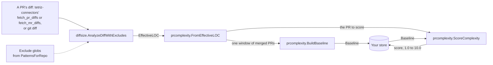

# prcomplexity

Line counts treat a hand-written Go change like a regenerated lock file, and a size that is routine in one repository is large in another, so comparing pull request effort across teams misleads. `prcomplexity` scores each pull request from 1.0 to 10.0 against its own repository's recent merged pull requests, one language at a time, so a PR of the repository's typical size scores about 5 wherever it came from.

## Contents

- [What it does](#what-it-does) lists the entry points and how they fit together.
- [Quick start](#quick-start) scores one pull request in a short complete program.
- [Choosing an entry point](#choosing-an-entry-point) maps what you have to the call to make.
- [Usage](#usage) shows each entry point in a complete program.
- [Reference](#reference) gives the exact rules, defaults and errors.
- [Before you rely on it](#before-you-rely-on-it) lists where sizes and scores can mislead, most harmful first.
- [Project](../README.md#project), at the repository root, covers versioning, tests, contributing, security and the license.

## What it does

The `prcomplexity` package scores a PR (`ScoreComplexity`) and builds the per-language baseline it scores against (`BuildBaseline`). `FromEffectiveLOC`, `CodeSlices`, `IsCodeLanguage` and `Median` are the helpers both calls share.

Its sizes come from [`diffsize`](../diffsize/README.md), the package in this repository that turns a diff into per-language effective lines of code.

[Choosing an entry point](#choosing-an-entry-point) maps what you have to the call to make.

Every function is stateless: no I/O, no clock, no network. The program that calls them chooses the windows and keeps the baselines and scores.

### How it fits together



### What it does not do

- It does not fetch diffs. Pass the bytes from `git diff`, or from tetriz-connectors, which syncs pull requests and their diffs from GitHub, GitLab and Bitbucket.
- It does not choose the window of PRs, store baselines, or track a PR's status over time. Those belong to the program that calls it, as [docs/prcomplexity/method.md](../docs/prcomplexity/method.md) describes.
- It does not label scores High, Medium or Low. Bands are a reading choice.
- It does not exclude bot-authored PRs from a sample. Filter them before `BuildBaseline`.

## Quick start

You need Go 1.25.2 or later, and nothing else.

```sh
go get github.com/tetriz-ai/tetriz-engineering-intelligence@v0.1.0
```

```go
// Command score-one-pr scores one pull request against a stored baseline.
package main

import (
	"fmt"
	"log"

	"github.com/tetriz-ai/tetriz-engineering-intelligence/prcomplexity"
)

func main() {
	// A repository's Go baseline, as prcomplexity.BuildBaseline returns it.
	baseline := &prcomplexity.Baseline{PerLanguage: map[string]prcomplexity.LanguageStats{
		"Go": {MedianSLOC: 72, MedianFiles: 4, MuLogSLOC: 4.36, SigmaLogSLOC: 0.92, MuLogFiles: 1.41, SigmaLogFiles: 0.37},
	}}
	pr := map[string]prcomplexity.LanguageLOC{"Go": {SLOC: 300, Files: 6}}

	score, ok, err := prcomplexity.ScoreComplexity("pr-42.patch", pr, baseline, prcomplexity.FormulaCNCS, prcomplexity.DefaultDecay)
	if err != nil {
		log.Fatal(err)
	}
	fmt.Println(*score, ok)
}
```

```text
9.3 true
```

The PR adds 300 source lines in 6 files, about four times the repository's median of 72 lines in 4 files, so it scores 9.3 of 10. `true` says it was scoreable.

## Choosing an entry point

| You have | Use | Example |
|---|---|---|
| Per-language sizes and a stored baseline | [`ScoreComplexity`](#score-a-pr) | [score-one-pr](../examples/score-one-pr/) |
| A PR's diff bytes | [`AnalyzeDiffWithExcludes`, then `FromEffectiveLOC`](#score-a-diff) | [score-a-diff](../examples/score-a-diff/) |
| Diffs that tetriz-connectors fetched | [The same, routed by the diff reference](#use-with-tetriz-connectors) | In the section |
| A diff, and only its line counts | [`AnalyzeDiffWithExcludes`](../diffsize/README.md#count-a-diffs-lines) | [count-loc](../examples/count-loc/) |
| Generated or lock files to leave out | [`PatternsForRepo` and exclude globs](../diffsize/README.md#exclude-files) | In the section |
| Each file's added content | [`ParseUnifiedDiff` or `ParseGitLabDiffs`](../diffsize/README.md#parse-a-diff) | In the section |
| A window of a repository's merged PRs | [`BuildBaseline`](#build-a-baseline) | [score-held-out-prs](../examples/score-held-out-prs/) |
| A window too thin for the default gates | [`BuildBaseline`](#build-a-baseline) with lowered gates | [handle-a-thin-window](../examples/handle-a-thin-window/) |

## Usage

### Score a PR

When: you have a PR's added source lines and files per language, and the repository's baseline.

The quick start above is the complete program. `FormulaCNCS`, the default and what the empty `Formula` means, scores each language by how far its size sits from the repository's typical size on a log scale. `FormulaRatio` scores the size's ratio to the repository's median instead.

Remember:

- Check `ok` before reading the score: an unscoreable PR returns a nil score and no error.
- `diffRef` matters only when it is a sentinel. `DiffNotAvailable` (`"NOT_AVAILABLE"`) is unscoreable. `DiffTooLarge` (`"TOO_LARGE"`) gets a placeholder score of 7.0, not a measurement, as [Scores](#scores) explains.

### Score a diff

When: you have the PR's diff, a git unified diff or GitLab's merge-request diffs JSON.

```go
package main

import (
	"fmt"
	"log"

	"github.com/tetriz-ai/tetriz-engineering-intelligence/diffsize"
	"github.com/tetriz-ai/tetriz-engineering-intelligence/prcomplexity"
)

const diff = `diff --git a/server/health.go b/server/health.go
--- /dev/null
+++ b/server/health.go
@@ -0,0 +1,6 @@
+package server
+
+// Health reports that the server is up.
+func Health() string {
+	return "ok"
+}
`

func main() {
	loc, err := diffsize.AnalyzeDiffWithExcludes([]byte(diff), diffsize.FormatUnified, []string{"*.lock"})
	if err != nil {
		log.Fatal(err)
	}
	byLanguage := prcomplexity.FromEffectiveLOC(loc)
	fmt.Println(byLanguage)

	baseline := &prcomplexity.Baseline{PerLanguage: map[string]prcomplexity.LanguageStats{
		"Go": {MedianSLOC: 72, MedianFiles: 4, MuLogSLOC: 4.36, SigmaLogSLOC: 0.92, MuLogFiles: 1.41, SigmaLogFiles: 0.37},
	}}
	score, ok, err := prcomplexity.ScoreComplexity("health.patch", byLanguage, baseline, "", prcomplexity.DefaultDecay)
	if err != nil {
		log.Fatal(err)
	}
	fmt.Println(*score, ok)
}
```

```text
map[Go:{4 1}]
1.3 true
```

Remember:

- The format is `diffsize.FormatUnified` or `diffsize.FormatGitLabJSON`. Any other value, GitLab JSON that does not parse, and an invalid exclude glob are errors.
- Vendored, documentation and some generated files never reach `byLanguage`. [Sizes](../diffsize/README.md#sizes) lists which, so pass globs for your generated paths.

### Use with tetriz-connectors

When: tetriz-connectors fetches your pull requests' diffs, and you score them.

Its `fetch_pr_diffs` operation (GitHub and Bitbucket) and `fetch_mr_diffs` operation (GitLab) store each diff in a blob store. Each reports the blob key, or `TOO_LARGE` or `NOT_AVAILABLE` in its place. Pass that value through as the diff reference, and read the diff by it:

| The diff reference | What to do |
|---|---|
| A key ending in `.json` | Analyse it with `FormatGitLabJSON`, GitLab's merge-request diffs JSON |
| Any other key | Analyse it with `FormatUnified` |
| `TOO_LARGE` or `NOT_AVAILABLE` | Pass it to `ScoreComplexity` as it is |
| A GitLab key with a `too_large` or `collapsed` file your exclude globs match | Nothing special: the file is listed in `ExcludedFiles` and the rest of the diff is scored |
| A key whose analysis returns `ErrDiffExcluded` (a flagged file no glob matches) | Score the PR as `DiffTooLarge`, for `too_large` and `collapsed` alike, because a diff read from a store cannot be refetched |

```go
package main

import (
	"errors"
	"fmt"
	"log"
	"strings"

	"github.com/tetriz-ai/tetriz-engineering-intelligence/diffsize"
	"github.com/tetriz-ai/tetriz-engineering-intelligence/prcomplexity"
)

// blobs stands in for the blob store the diff fetches write to.
var blobs = map[string]string{
	"pr-diffs/org-1/github/101/7.patch": "diff --git a/main.go b/main.go\n--- /dev/null\n+++ b/main.go\n" +
		"@@ -0,0 +1,3 @@\n+package main\n+\n+func main() {}\n",
	"pr-diffs/org-1/gitlab/202/8.json": `[{"new_path": "big.go", "diff": "", "too_large": true}]`,
	"pr-diffs/org-1/gitlab/202/9.json": `[{"new_path": "main.go", "diff": "@@ -0,0 +1,3 @@\n+package main\n+\n+func main() {}\n"},` +
		`{"new_path": "package-lock.json", "diff": "", "too_large": true}]`,
}

// scoreStoredDiff scores one PR from the diff reference its fetch reported.
func scoreStoredDiff(diffRef string, excludes []string, baseline *prcomplexity.Baseline) (*float64, bool, error) {
	byLanguage := map[string]prcomplexity.LanguageLOC{}
	if diffRef != prcomplexity.DiffTooLarge && diffRef != prcomplexity.DiffNotAvailable {
		format := diffsize.FormatUnified
		if strings.HasSuffix(diffRef, ".json") {
			format = diffsize.FormatGitLabJSON
		}
		loc, err := diffsize.AnalyzeDiffWithExcludes([]byte(blobs[diffRef]), format, excludes)
		switch {
		case errors.Is(err, diffsize.ErrDiffExcluded):
			diffRef = prcomplexity.DiffTooLarge // a stored diff cannot be fetched again
		case err != nil:
			return nil, false, err
		default:
			byLanguage = prcomplexity.FromEffectiveLOC(loc)
		}
	}
	return prcomplexity.ScoreComplexity(diffRef, byLanguage, baseline, prcomplexity.FormulaCNCS, prcomplexity.DefaultDecay)
}

func main() {
	baseline := &prcomplexity.Baseline{PerLanguage: map[string]prcomplexity.LanguageStats{
		"Go": {MedianSLOC: 72, MedianFiles: 4, MuLogSLOC: 4.36, SigmaLogSLOC: 0.92, MuLogFiles: 1.41, SigmaLogFiles: 0.37},
	}}
	// From GetVCSSettings: file_exclude_patterns and repo_file_exclude_overrides.
	excludes := diffsize.PatternsForRepo("example/api", []string{"*.pb.go", "go.sum", "package-lock.json", "*.lock"}, nil)

	for _, ref := range []string{"pr-diffs/org-1/github/101/7.patch", "pr-diffs/org-1/gitlab/202/8.json", "pr-diffs/org-1/gitlab/202/9.json", prcomplexity.DiffNotAvailable} {
		score, ok, err := scoreStoredDiff(ref, excludes, baseline)
		if err != nil {
			log.Fatal(err)
		}
		if !ok {
			fmt.Println(ref, "unscoreable")
			continue
		}
		fmt.Println(ref, *score)
	}
}
```

```text
pr-diffs/org-1/github/101/7.patch 1.3
pr-diffs/org-1/gitlab/202/8.json 7
pr-diffs/org-1/gitlab/202/9.json 1.3
NOT_AVAILABLE unscoreable
```

Remember:

- Take the exclude globs from tetriz-connectors' `GetVCSSettings` RPC. Pass its `file_exclude_patterns` as `PatternsForRepo`'s `orgPatterns`, and its `repo_file_exclude_overrides` as `overrides`: each entry's `patterns`, keyed by the repository's full name.
- Build each baseline from the repository's merged PRs on the branch its VCS settings track: its `repo_branch_overrides` entry, else `tracked_branch`, else the default branch. Use every branch when `track_all_branches` is on or the repository is in `repo_all_branches`.

### Build a baseline

When: you have one window of a repository's merged PRs and want the anchors to score against.

```go
package main

import (
	"fmt"
	"log"

	"github.com/tetriz-ai/tetriz-engineering-intelligence/prcomplexity"
)

func main() {
	var sample []prcomplexity.SamplePR
	for i := 1; i <= 40; i++ {
		sample = append(sample, prcomplexity.SamplePR{
			DiffRef:    fmt.Sprintf("pr-%d.patch", i),
			Analyzed:   true,
			ByLanguage: map[string]prcomplexity.LanguageLOC{"Go": {SLOC: int64(10 * i), Files: 1 + i%4}},
		})
	}

	baseline, err := prcomplexity.BuildBaseline(sample, prcomplexity.DefaultBaselineOptions())
	if err != nil {
		log.Fatal(err)
	}
	goStats := baseline.PerLanguage["Go"]
	fmt.Println(baseline.SampleSize, baseline.CoverageBps, goStats.MedianSLOC, goStats.MedianFiles)
}
```

```text
40 10000 205 3
```

Remember:

- A sample that fails a gate returns the counts and an error wrapping `ErrNotEnoughData`. Test for it with `errors.Is`. The [handle-a-thin-window](../examples/handle-a-thin-window/) example shows what to do then.
- Pass the PRs in a stable order, such as by open time then ID. The log statistics sum in sample order, so another order can change their last bits.

More: the full API is on [pkg.go.dev](https://pkg.go.dev/github.com/tetriz-ai/tetriz-engineering-intelligence/prcomplexity), and every example is listed in [examples/README.md](../examples/README.md). The method behind the numbers, and what a host program owns, is in [docs/prcomplexity/method.md](../docs/prcomplexity/method.md).

## Reference

### ScoreComplexity

`ScoreComplexity(diffRef, byLanguage, baseline, formula, decay)` returns the score, whether the PR was scoreable, and an error for invalid input.

| Input | Result |
|---|---|
| `diffRef` is `DiffNotAvailable` | nil, false |
| `diffRef` is `DiffTooLarge` | 7.0, true |
| No code language with added lines | nil, false |
| No code language with an anchor the formula can use | nil, false |
| Otherwise | the score, rounded to one decimal, true |

- **Code languages** are go-enry's Programming and Markup types plus Protocol Buffer. Keys are go-enry's exact language names: "go" is not "Go", so it is not code.
- **`FormulaCNCS`** scores each dimension `clamp(1 + 9 / (1 + exp(-1.702 z)), 1, 10)` with `z = (log(value + 1) - mu) / sigma`. It skips a language whose `MuLogSLOC` is 0.
- **Sigma guards** replace a SLOC sigma outside 0.8 to 3.0 with 2.0, and a files sigma outside 0.3 to 2.0 with 0.8. `SigmaLogSLOCMin`, `SigmaLogSLOCMax`, `SigmaLogFilesMin` and `SigmaLogFilesMax` hold the bounds.
- **`FormulaRatio`** scores `value / median` as 1.0 up to 0.2, then `5 x ratio` up to 1, then `10 - 5 / ratio`. It skips a language with a median of 0.
- **Within a language,** the slice score is `0.8 x the higher dimension + 0.2 x the lower`.
- **Across languages,** sorted descending, the slice scores sum with weights 1, decay, decay squared and so on, capped at 10. `DefaultDecay` is 0.3.
- **Errors:** an unknown formula, a decay outside [0, 1] or NaN, a negative SLOC or file count, and a NaN or infinite log statistic in the baseline. The score is then nil and `ok` false.

### BuildBaseline

`BuildBaseline(sample, options)` returns per-language medians and log statistics, or an error when the window fails a gate.

| Gate | Default | Passes when |
|---|---|---|
| Sample size | 30 (`DefaultMinSampleSize`) | more than 30 PRs |
| Coverage | 9500 bps, basis points (`DefaultCoverageThresholdBps`) | more than 9500 bps, after truncation to whole basis points |
| Per language | 30 (`DefaultMinSampleSize`) | at least 30 PRs touch it |

- **Usable** means `Analyzed`, or a `DiffRef` of `DiffTooLarge`. `DiffNotAvailable` and an empty `DiffRef` are not usable.
- **Per language,** both medians must be above zero.
- **Medians** are integers. An even count rounds the middle pair's mean half away from zero.
- **Errors:** a `MinSampleSize` below 1, a `CoverageThresholdBps` outside [0, 10000), and a negative SLOC or file count in the sample. The baseline is then nil. Start from `DefaultBaselineOptions()` and change the field you need.
- **A `DiffTooLarge` PR** counts toward coverage and adds nothing to the medians, even when it carries a footprint.
- **Log statistics** winsorise at the sorted value at index `floor(0.95 n)`, at least 1.

## Before you rely on it

Check these before you put sizes or scores in front of people. Each is pinned by the test named with it.

### Sizes

Every size limit that `diffsize` lists under [Before you rely on it](../diffsize/README.md#before-you-rely-on-it) reaches the score through `FromEffectiveLOC`.

### Scores

**Scores a PR as more complex than its code (can mislead):**

- A `DiffTooLarge` (`"TOO_LARGE"`) PR scores a flat 7.0, whatever it holds. A diff over the caller's size cap is usually inflated by binaries or generated assets, so 7.0 is usually above its real code. Pinned in `prcomplexity/complexity_test.go`, `TestScoreComplexity`.

**Leaves a PR unscored or under-counted (less harmful):**

- A language with fewer than 30 PRs in the window has no anchor. Its slice is dropped, and a PR with no anchored language is unscoreable. Pinned in `prcomplexity/complexity_test.go`, `TestScoreComplexity`.
- Medians are integers, so the ratio formula sees a median of 1.5 as 2. Pinned in `prcomplexity/complexity_test.go`, `TestMedian`.
- A huge PR of real code over the caller's size cap also scores 7.0, below what its size would earn. Pinned in `prcomplexity/complexity_test.go`, `TestScoreComplexity`.

### Baselines

**Admits a baseline it should not (can mislead):** none known.

**Withholds a baseline (less harmful):**

- Both window gates are strict. Exactly 30 PRs, or exactly 95.00% coverage, gives no baseline. Pinned in `prcomplexity/baseline_test.go`, `TestBuildBaseline_StrictGates`.
- A language whose large PRs are all `DiffTooLarge` can fall below 30 PRs and lose its anchor, because those PRs add nothing to its count. Pinned in `prcomplexity/baseline_test.go`, `TestBuildBaseline_TooLargeFootprintAddsNothingToMedians`.
